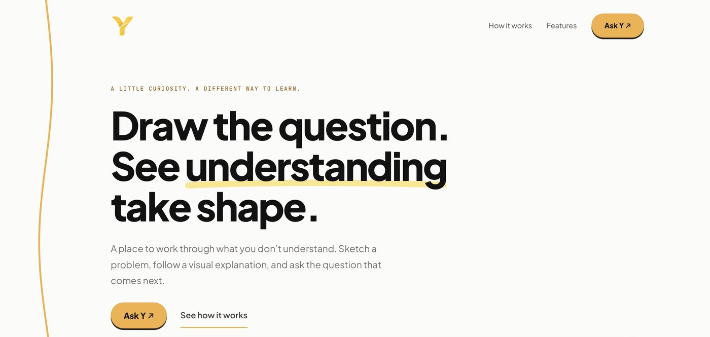
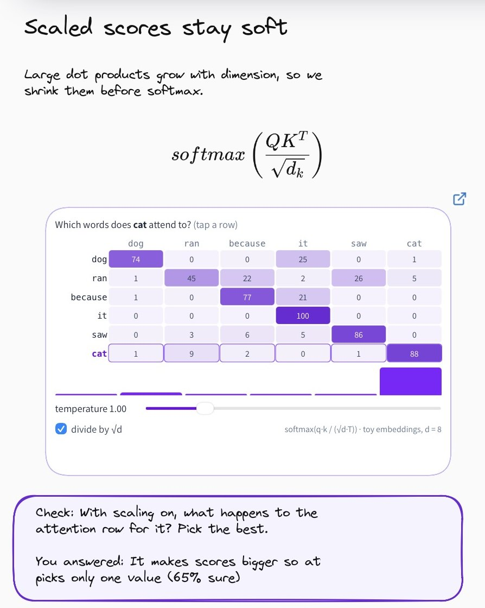
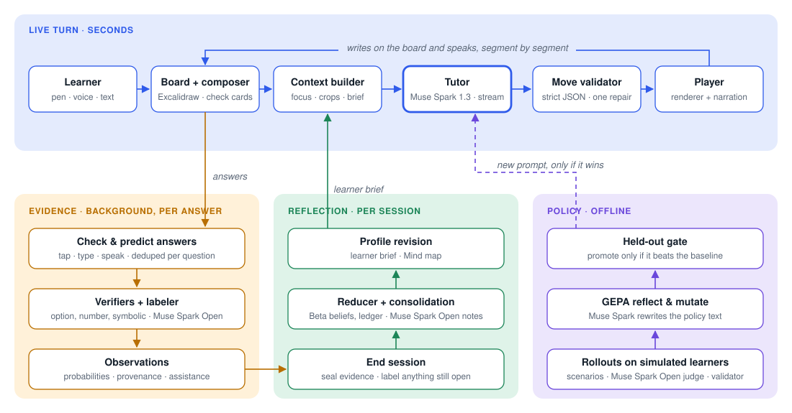
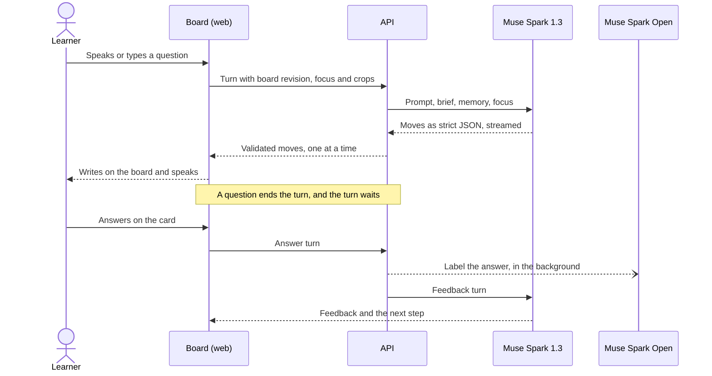
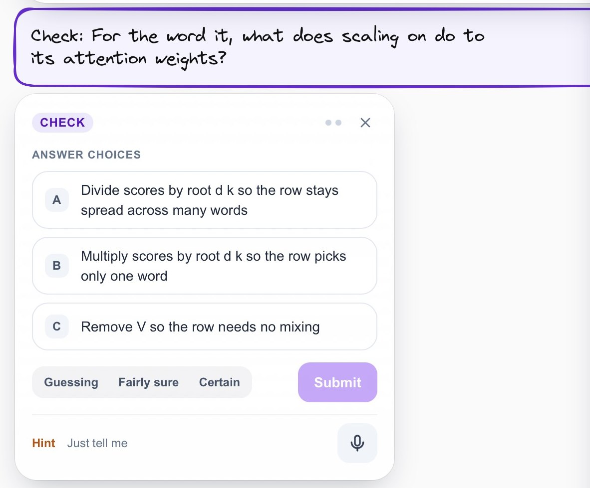
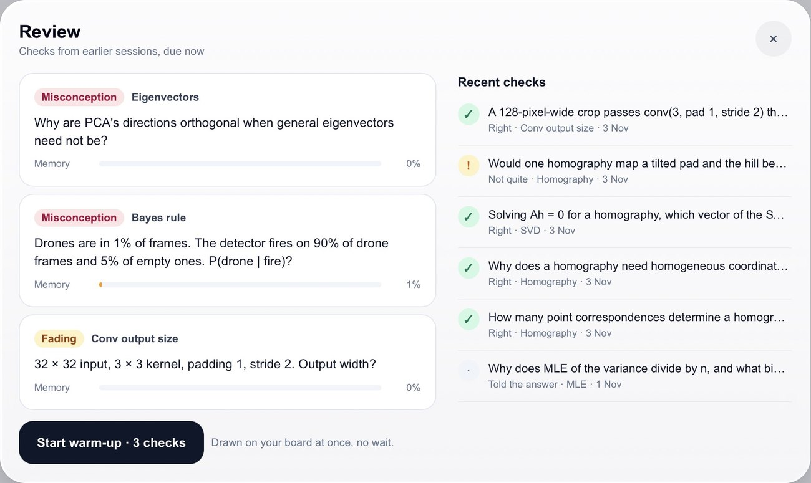
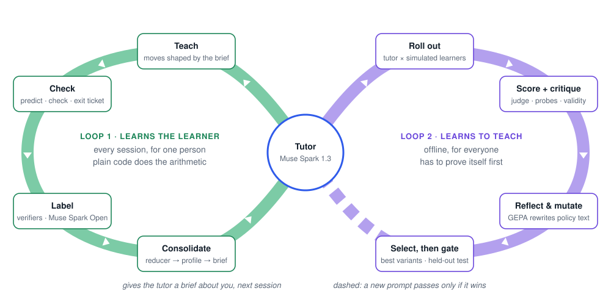
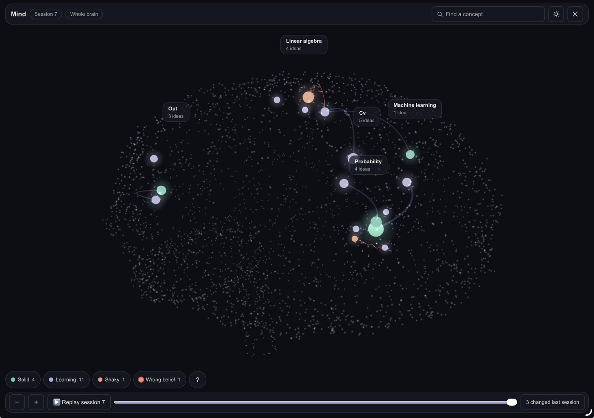
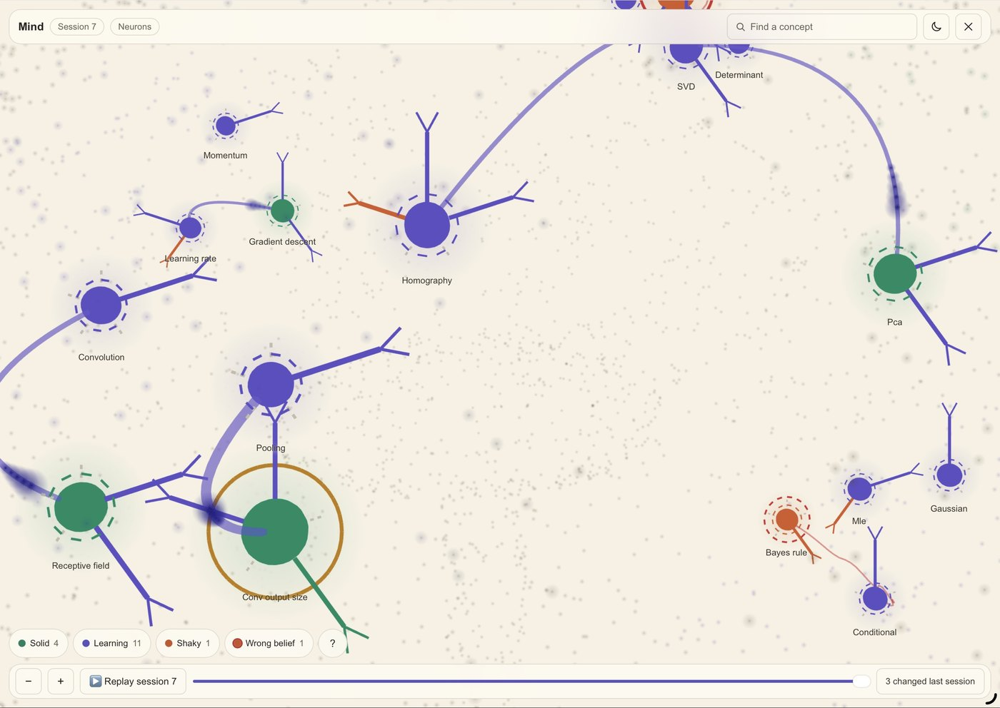
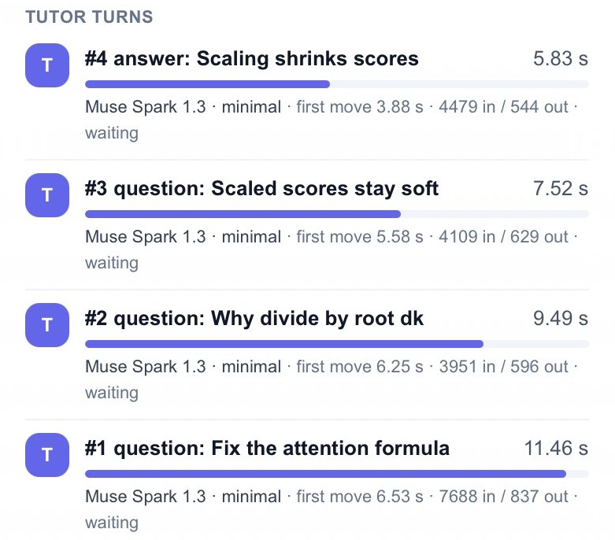

<p align="center">
  
</p>

# Y: a whiteboard tutor that learns how you think

**Ask anything. Y teaches on a shared whiteboard, checks your understanding as it goes, and remembers how you think, so your next lesson meets 
you where you are.**

Built for the Meta Global AI Developer Hackathon on Meta's models: Muse Spark, Muse Spark Open, Muse Voice Transcribe and Muse Image.

> **Hackathon submission:** [ask-Y](https://github.com/Abhijithreddydasari/ask-Y) is the entry and holds only the work from the event. This repository is the full project: the code from before the event, the event's work, and its development history.

**Live demo:** <https://ask-y-event.vercel.app/app> · **Run it yourself:** [setup](#setup), with two API keys

**Contents:** [Why](#why-y-exists) · [What](#what-y-is) · [How](#how-it-works) · [Board artifacts](#what-appears-on-the-board) ·
[Self-learning](#how-y-learns) · [Models](#meta-models-used) · [Measurements](#what-we-measured) ·
[Before and after](#the-codebase-before-and-after-the-event) · [Setup](#setup) · [Repository map](#repository-map) ·
[Limits](#limits) · [Troubleshooting](#troubleshooting)

---

## Why Y exists

Most AI tutors are answer engines. You ask, they explain, you nod, and nothing is remembered. That leaves three problems.

**Explaining isn't learning.** Reading a good explanation feels like understanding. Hearing an answer doesn't show you could produce it, and a
chatbot can't tell the difference. A tutor has to find out what you know by asking, and take a wrong answer seriously.

**Wrong beliefs survive, because nobody tracks them.** Someone who thinks softmax "evens the scores out" will get the next question wrong for
the same reason. A good human tutor notices that pattern and goes back to it. Chat tools start again every session.

**Some questions are easier to draw than to type.** Maths, diagrams and worked steps belong on a board you can point at, not in a text box.

We built Y to act like a good tutor at a whiteboard: teach one step at a time, ask before moving on, remember what you got wrong and why, and show
its reasoning instead of asking you to trust it.

## What Y is

Y is a shared whiteboard with a tutor on it. You speak or type a question, and it teaches beside your work.

- **It teaches on the board.** Lessons appear as handwritten steps, equations, editable diagrams and interactive widgets, with a voice that
  follows the writing.
- **It asks as it goes.** Lessons pause on a question you answer by tapping, typing or speaking. Wrong answers get a different explanation, not
  the same one repeated.
- **It builds a model of you.** Each answer becomes evidence about what you know. Beliefs carry honest uncertainty, and a wrong belief gets a
  name, backed by the answers that show it.
- **It shows its reasoning.** A chip on the board says why a lesson starts where it does, **Mind** shows the evidence behind every concept, and
  **Trace** shows which model did what and how long it took.

<p align="center">
  
  <br /><em>A lesson: handwritten steps, KaTeX, a live attention widget, and a check with the learner's answer and confidence.</em>
</p>

## How it works

Y runs four loops on four timescales. Only the first is on the clock, so the slower thinking never makes a learner wait.

<p align="center">
  
</p>

| Loop | When | What it does | Models |
|---|---|---|---|
| **Live turn** | Seconds | Streams validated teaching moves onto the board | Muse Spark 1.3, Muse Voice Transcribe, Muse Image |
| **Evidence** | Background, per answer | Grades and labels each answer; a failure never reaches the lesson | Muse Spark Open |
| **Reflection** | At End session | Seals one profile revision, with cited notes and named beliefs | Muse Spark Open; the numbers come from code |
| **Policy** | Offline | Proposes prompt changes and tests them on students it never trained on | Muse Spark 1.3, Muse Spark Open |

The Tutor box, with the heavier outline, is the only paid call a learner waits on.

### One turn, end to end

Each tutor call is stateless and receives one bounded context packet: the system prompt, the learner brief, session memory, the board focus with up
to two image crops, and this turn. The reply is strict JSON, streamed and parsed as it arrives, so each move reaches the board as soon as it's complete.
A question ends the turn, and your answer starts the next one.



**Keeping the model honest, cheapest check first:**

- **Constrained output.** A strict schema makes malformed moves impossible, and only moves the board can render are allowed.
- **A validator for meaning.** It catches things a schema can't, such as a key that isn't among the options. A bad turn gets one repair, then the
  bad move is dropped.
- **Deterministic grading first.** Option, number and symbolic verifiers run before any model. A key audit catches a wrong answer key from the
  tutor, so you aren't marked wrong for being right.
- **Untrusted input stays untrusted.** Learner answers and ink are evidence, never instructions.

## What appears on the board

The tutor doesn't write free-form output. It picks from a fixed set of typed moves, and the app renders them. It can't run generated code: widgets are
our own components, driven by validated specs. Everything lands on one [Excalidraw](https://excalidraw.com) canvas, so it pans, zooms and saves with your
own ink.

| Artifact | What you see | How it's made |
|---|---|---|
| **Handwritten steps and headings** | Text written across the time the voice takes to say it | `seg` and `write` moves, through the renderer |
| **Equations** | Exact maths, typeset | `equation`, rendered with KaTeX |
| **Diagrams** | Flowcharts and sequences as real board shapes you can edit | `diagram`: the tutor writes Mermaid, which becomes Excalidraw shapes |
| **Illustrations** | A picture for a visual idea, arriving shortly after the lesson continues | `image`: Muse Image, in the background, behind a placeholder |
| **Rings on your work** | A circle around the exact line of your handwriting that went wrong | `point`: Muse Spark reads the crop, and the server snaps the ring to that line |
| **"Because" chips** | A short note on why this lesson starts here, such as "you thought this last time" | `because`: must cite a real item in your profile, or it's dropped |
| **Question cards** | Predict or check, by tap, typing or voice, with a confidence setting | `predict` and `check`, with hints and "just tell me" |

**Interactive widgets** run in your browser, with no model call when you move a slider:

| Widget | What you do with it |
|---|---|
| `attention` | Tap a token to see what it attends to, move the temperature, and toggle the √d scaling |
| `plot` | Graph a function with named axes, and drag sliders for its parameters |
| `matrix` | Edit a 2D matrix and watch what it does to the unit square |
| `stepper` | Step through a process or algorithm one stage at a time |

Model-written interactive simulations were in our original plan. We deferred them because running generated code safely needs a proper sandbox.

**Around the lesson:**

- **Voice.** Push-to-talk through Muse Voice Transcribe, biased with terms from your own board so jargon comes through. Narration follows the board,
  and the question appears once the explanation has finished.
- **Study loop.** A warm-up re-asks checks that are due, with no model call. A hint ladder goes from nudge to step to reveal, and using it counts as
  assistance. End session offers an exit ticket. **Canvases** reopens saved boards.

<table>
  <tr>
    <td width="42%"></td>
    <td width="58%"></td>
  </tr>
  <tr>
    <td><em>A check: answer with confidence, ask for a hint, or say "just tell me".</em></td>
    <td><em>Review: what's due, and why, from earlier sessions.</em></td>
  </tr>
</table>

## How Y learns

"Self-learning" can mean two different things, and we keep them apart while joining them at the tutor. **Loop 1 learns about you**, every session. **Loop 2 tries
to learn how to teach better**, offline, and has to prove it before anything changes.

<p align="center">
  
</p>

### Loop 1: learning the learner

Y separates **what a model judges** from **what code concludes**. Models read answers and name beliefs. Plain, tested code does the arithmetic, so your
profile never depends on a model's mood.

**1. Every answer becomes an observation.** One per question, with its source. Deterministic verifiers go first, then the labeler fills in what they can't decide:

| Field | Values | Used for |
|---|---|---|
| Outcome | correct, partial, incorrect, unanswered, each with a probability | How your belief moves |
| Misconception | this check's wrong options, known beliefs, or "another", with probabilities | The ledger |
| Miss class | cue, discrimination, execution, careless, structural | Why you missed |
| Reasoning | not shown, flawed, surface, sound, insightful | Briefed to the tutor; never changes mastery |
| Key validity | valid, invalid, unsure | Lowers trust in a bad question |

**2. End session runs the reducer.** No model decides these numbers:

- **Beliefs.** A Beta distribution per concept and dimension. Each answer moves it by expected credit, `p(correct) + ½ p(partial)`, weighted by answer
  format, trust in the answer key, and whether a hint was used. Beliefs drift back toward unknown over time, on a half-life that grows with spaced recall.
- **Misconception ledger.** An answer adds `p(misconception) × p(miss) × weight`. An entry appears as *suspected* at 0.15 and becomes *active* at 0.5. It's
  *resolved* only after two answers' worth of clean credit, with no recurrence.
- **Named beliefs.** In the same close call, Muse Spark Open groups flagged answers by the belief behind them and names it, such as "treats softmax as making all
  weights roughly equal". A name must cite the answers it rests on, and can only merge into entries that really exist, so a model error can miss a merge
  but can't invent one. A single bare number is held back, because it's usually a slip.
- **Teaching notes.** One actionable sentence each, such as "confront this with a small numeric example". A note with no valid citation is dropped.

**3. The brief shapes the next lesson.** Compiled by code, with no model call: at most 24 items and 2,400 characters, holding only items about this
turn's topic, each citing its evidence. That's where the "because" chip comes from. With **Memory off**, the tutor reads nothing from earlier sessions.

**4. Mind shows you all of it.** A replayable 3D map, by session, that you can search and filter. Zoomed out it's a lit brain; zoomed in, each concept is a
neuron with its state, and links carry the reasoning between ideas. Each one opens to the evidence behind it.

<table>
  <tr>
    <td></td>
    <td></td>
  </tr>
  <tr>
    <td><em>Zoomed out: what you know, by topic, with replay across sessions.</em></td>
    <td><em>Zoomed in: solid, learning, shaky and wrong-belief neurons.</em></td>
  </tr>
</table>

To see this with weeks of history, open **Settings → Try as…** and pick Priya, Tomás or Amara. Each is a private copy, labelled as seeded, built through the
same capture and close path.

### Loop 2: learning to teach, with GEPA

Loop 1 adapts to one person. **GEPA** (Genetic-Pareto) works on a different question: can Y improve how it teaches everyone?

GEPA is an optimizer that evolves prompt text. Instead of guessing at changes, it runs a prompt, reads written critiques of what went wrong, has a model
rewrite the prompt, and keeps the variants that score best. Here it evolves three sections of the tutor's prompt: `pedagogy_policy`, `check_writer` and
`feedback_policy`. The move schema and personalization rules stay byte-identical.

**How it's tested:**

1. **A simulated student holds a hidden misconception**, from 24 scenarios across the three personas (9 train, 6 validation, 9 held out). In 15, the tutor isn't told
   about the misconception.
2. **The tutor teaches through the real path**, with the same validator: question, answer, feedback, answer.
3. **Each run is scored:** the judge (0.35), whether the belief was resolved (0.20), whether a check actually probed it (0.15), whether the tutor addressed
   it (0.10), valid moves (0.10) and length (0.10). The judge's written critique is what GEPA learns from.
4. **A held-out gate decides.** A new prompt is promoted only if it beats the current one by at least 0.05 on students it never saw, with no drop in valid moves.

**What happened: the gate refused the change.**

| | Current prompt | GEPA's best candidate |
|---|---|---|
| Validation (6 scenarios, GEPA saw these) | 0.745 | 0.832 |
| **Held out (9 scenarios × 2 repeats)** | **0.822** | **0.802** (gain −0.020) |
| Valid moves | 1.000 | 1.000 |

The 90% interval on the gain is −0.096 to +0.053. On validation alone the candidate looked like a clear win, and promoting it would have shipped a
slightly worse tutor. So **the live prompt is unchanged**, and the gate did the job it exists for.

The reason is instructive. GEPA rewrote only `feedback_policy`, producing calculation drills that drifted away from the misconception. Where it did help, on two
hidden misconceptions, its checks more often carried the wrong idea as an option. The run also showed what a stronger test needs: simulated students who hold
their beliefs longer, and more validation scenarios.

The run made 838 paid calls and cost $2.51 on Muse Spark 1.3, plus Baseten usage. Tutor, student, judge and rewriting all ran on Meta models. A one-off cross-check on
the held-out set used `gpt-6-luna` from another model family, and it agreed with the verdict. That was offline only and isn't in the app.

GEPA runs offline, by hand, and promotion is manual; it isn't a background job. See the [full report](docs/reports/H10-policy-eval.md), with worked examples, and the
[candidate prompt](docs/reports/H10-candidate-tutor.md).

## Meta models used

| Job | Model | Key |
|---|---|---|
| Live tutor, reading the board, pointing at mistakes | Muse Spark 1.3 (the picker also offers 1.2 and Muse Spark Open) | `MODEL_API_KEY` |
| Speech to text, biased with terms from your board | Muse Voice Transcribe | `MODEL_API_KEY` |
| Board illustrations | Muse Image | `MODEL_API_KEY` |
| Evidence labels, including handwriting crops | Muse Spark Open | `BASETEN_API_KEY` |
| Session-close notes and belief names | Muse Spark Open | `BASETEN_API_KEY` |
| GEPA: tutor and prompt rewriting / student and judge | Muse Spark 1.3 / Muse Spark Open | Both |

With these two keys, every model call goes to a Meta model. Narration uses your browser's built-in voice, because Meta has no text-to-speech model. Two optional
extras are off unless you add them, and neither is a Meta model: hosted Deepgram voices with `DEEPGRAM_API_KEY`, and local Kokoro voices with
`uv sync --extra speech`. The [deployed demo](https://ask-y-event.vercel.app/app) offers both in its voice picker, and the browser voice stays its default.

**Trace** shows this routing live, for every turn:

<p align="center">
  
</p>

## What we measured

These are live results from our own small tests, not benchmarks. Sample sizes are in the table.

| What | Result |
|---|---|
| Tutor: question to first move on the board | p50 1.89 s, p95 2.25 s (20 turns) |
| Speech to text, for about 10 s of speech | p50 2.53 s |
| Board artifacts valid | 26 of 26 turns, 1 move dropped |
| Ring on the wrong line of handwriting | 11 of 11 (synthetic pen glyphs) |
| Labels: top misconception against hand labels | 26 of 26, twice |
| Labels: outcome against hand labels | 26 and 25 of 26, across two runs |
| Labels: clean answers wrongly added to the ledger | 0 of 14 |
| Labels: injection attempts marked correct | 0 of 2 |
| Answers only in an ink crop, labeled correctly | 12 of 12 (synthetic strokes and a font) |
| At close: real beliefs named / slips named / injections named | 6 of 6 / 0 of 4 / 0 of 2 |
| Label latency | p50 2.8 s, in the background |
| Memory on: the next session opens on the earlier misconception | 2 of 2 pairs; Memory off gave a generic opening, 2 of 2 |

We wrote the labeler test answers and hand labels ourselves, and most are clear-cut. Details are in the [labeler report](docs/reports/meta-labeler.md) and the
[capture check](docs/reports/capture-check.md).

## The codebase, before and after the event

Y began before the event, in the public repository [Abhijithreddydasari/Y](https://github.com/Abhijithreddydasari/Y). It already had a whiteboard, a renderer and a
learning profile, driving a local Gemma teacher. The event is when it became a tutor that questions you, remembers you and shows its work.

| | Before the event | Built during the event |
|---|---|---|
| **Tutor** | Gemma on Ollama, with tag-line primitives and one checkpoint at the end of a lesson | Muse Spark tutor with strict streamed moves, a validator, and a teaching policy that predicts, checks and reteaches |
| **Board** | Excalidraw board, renderer, and the Studio and Mobile shells | Saved board state and context, editable diagrams, live widgets, illustrations, rings on your ink, question cards |
| **Voice** | Local Moonshine speech input and Kokoro narration | Muse Voice Transcribe with board-term hints, narration in step with writing, browser voice by default |
| **Learner model** | A Bayesian state and a learner-adapter architecture, not trained or promoted | Evidence capture, probability-weighted beliefs, the misconception ledger, session close, the brief, visible personalization |
| **Learner view** | A learning profile panel and a knowledge atlas | Mind, a replayable 3D map with evidence behind each neuron |
| **Study** | One checkpoint after each lesson | Warm-up, hint ladder, exit ticket, Review, Canvases |
| **Proof** | Unit tests and a demo | Trace, seeded personas, live evaluations, and the GEPA policy evaluation with its gate |

**How the two repositories relate.** This repository holds everything, in one history. [ask-Y](https://github.com/Abhijithreddydasari/ask-Y) holds only the files created during the event, with their original commits and dates, and its setup fetches the older code from here at a pinned commit. `tools/sync_submission.py` builds it.

Some older code, such as the Gemma teacher, remains only for the classic board view, which the default interface doesn't show.

## Setup

You need [Node 20+](https://nodejs.org/), [git](https://git-scm.com/downloads) and [uv](https://docs.astral.sh/uv/getting-started/installation/) (uv installs a supported
Python if you need one). The commands are the same on Windows, macOS and Linux.

```bash
git clone https://github.com/Abhijithreddydasari/Y.git
cd Y
npm run setup
```

Put your two keys in the new `.env` file:

```text
MODEL_API_KEY=your Meta key
BASETEN_API_KEY=your Baseten key
```

Start the API and the web app in two terminals:

```bash
npm run api
```

```bash
npm run dev
```

Open <http://localhost:3000/app>. No other key or setting is needed.

### Try this

1. Ask a question, for example "why does attention use a softmax?". Y draws the lesson and asks you something.
2. Answer it wrongly on purpose, in words: "it evens the scores out so every token gets the same weight".
3. Press **End session** in the menu at the bottom right. Y seals what it learned about you.
4. Open **Mind** to see the belief it recorded and the answers behind it, and **Trace** to see each model call.
5. Ask about the same topic again. The new lesson starts from what you got wrong.

## Repository map

| Path | What it holds |
|---|---|
| `web/src/components` | Composer, question cards, widgets, Mind (`constellation/`), Trace, personas |
| `web/src/hooks`, `web/src/lib` | Turn orchestration, contracts, board controller, speech |
| `api/learning` | Tutor turn, moves and validator, evidence, labeler, learner model, close, voice, personas |
| `api/prompts/tutor-v1.md` | The tutor's policy, in the named sections GEPA evolves |
| `api/policy_eval` | GEPA adapter, simulated-student rollouts, judge, gate; labeler and ink checks |
| `docs/handoffs` | What each slice built, measured and left open |
| `docs/reports` | Evaluation reports, with raw results |
| `scripts/setup.mjs` | Installs everything and creates `.env` |
| `tools/sync_submission.py` | Builds the ask-Y repository from this one |
| `AGENTS.md`, `docs/workflow.md`, `docs/builds/ROADMAP.md` | Where development starts: conventions, current status, build order |

**Checks.** Tests are mocked and make no paid calls. Live checks are separate and paid: `api/policy_eval/label_check.py` and `ink_check.py`.

```bash
npm test
npm run lint
npm run build
```

```bash
cd api
uv run python -m pytest -q tests
```

## Limits

We would rather say these plainly.

- **Learning gains are not proven.** A live simulated-learner evaluation found Memory on cited the profile 5 of 5 times, but showed no gain in session-2 scores (0.50 on, 0.58
  off, small samples). Y changes what it teaches next; whether people retain more needs a study with real learners.
- **GEPA has improved nothing yet.** Its one full run was refused by the gate, and it trains on simulated students, not real learners' answers.
- **Probabilities are model-reported.** Their calibration has not been measured, and the learner model updates on them directly.
- **A half-right worded answer can be over-named.** Close can occasionally name a belief from a partly correct answer.
- **Typed text during an open question counts as its answer**, even if you meant to ask something new.
- **Not tested on real stylus handwriting**, or across every browser. Our tests for reading ink used synthetic strokes and a font.

Y is an educational prototype, and its judgments of your answers can be wrong.

## Troubleshooting

- **The page loads but questions fail.** Check that `npm run api` is still running on port 8101, and that both keys are set in `.env`. Restart the API after changing `.env`.
- **Windows blocks a SQLAlchemy DLL when the API starts** (Application Control). Reinstall it without compiled extensions, in CMD from `api`, then start the API with
  `npm run api`:

  ```bat
  set DISABLE_SQLALCHEMY_CEXT=1
  uv pip install --python .venv\Scripts\python.exe --reinstall --no-binary sqlalchemy "sqlalchemy==2.1.6" "typing-extensions==4.15.0"
  ```

- **No sound.** Tap or click once, and check that your device isn't muted. Your browser or system may have no speech voice installed. Lessons still draw, with captions.

## License

MIT.
