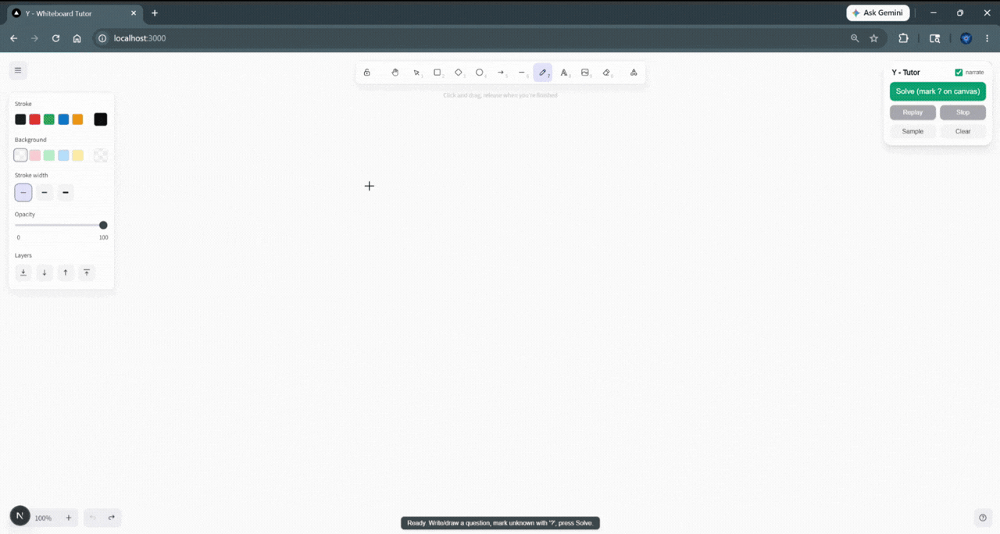
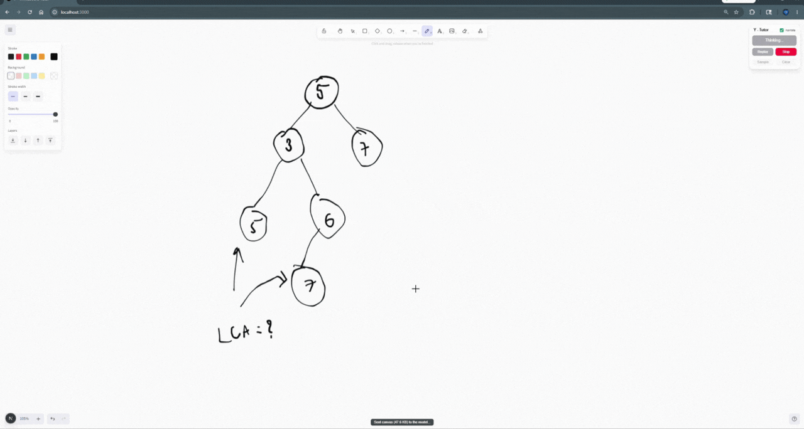
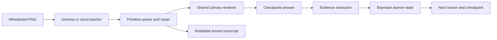

# Y — a whiteboard tutor that learns with you

Current development starts with [AGENTS.md](AGENTS.md),
[product goals](docs/GOALS.md), and the [thin-slice roadmap](docs/builds/ROADMAP.md).
See [the handoff](docs/workflow.md) for implemented versus planned behavior.
The older demo and learner-adapter description below is not the completion status
of the new shared-board workflow.

Y reads a learner's whiteboard, teaches on the same canvas, asks a short
checkpoint, and changes the next lesson using evidence from the answer. It is
built for the moment when a learner can draw the question more easily than
they can describe it.

The interface changes with the device; the learning loop does not. Tablets and
iPads get the full **Studio UI**. Phones get a guided **Mobile Demo UI** with
the same canvas, conversation, checkpoints, and learner profile.

<p align="center">
  
</p>

## The one-minute demo

1. Draw a question and mark the unknown with `?`, or insert a sample.
2. Press **Teach me**. Y reads the board and writes the explanation beside it.
3. Answer the checkpoint directly on the canvas.
4. Press **Check my answer**. Y gives feedback and updates the learning profile.
5. Open **Learning profile** to see concept evidence, uncertainty, and recent change.

The tablet experience keeps the full toolset, model controls, replay,
narration, teacher notes, chat, and hierarchical knowledge atlas. The phone
experience reduces that surface to one guided action at a time.

<p align="center">
  
</p>

A narrated end-to-end recording is available in
[Full_Demo.mp4](./assets/Full_Demo.mp4).

## What works today

- A multimodal teacher reads an Excalidraw canvas and streams a constrained
  whiteboard primitive language.
- Explanations render incrementally as text, equations, arrows, boxes, and
  diagrams instead of arriving as a wall of prose.
- Each lesson ends with a personalized checkpoint. The answer is assessed as
  probabilistic evidence, not a permanent label.
- A Bayesian learner state tracks concept mastery, uncertainty, evidence
  count, misconceptions, and recent direction of change.
- The knowledge atlas groups open-vocabulary concepts into a navigable
  hierarchy.
- Typed chat continues the current lesson. Local Moonshine speech input and
  Kokoro narration are optional in the local Studio build.
- Gemma through Ollama is the private/local path. OpenAI and Google teacher
  providers remain optional integrations.

The repository contains a 9.43M-parameter learner-adapter architecture with
per-user LoRA fast weights, training, and evaluation code. A promoted trained
checkpoint is **not included in this repository today**. Until one passes the
evaluation gates, the product uses the working Bayesian state and labels that
mode honestly in the interface.

## Architecture



The teacher and learner model have separate responsibilities. The teacher
interprets the board and plans an explanation. The learner state records only
concept-specific evidence and supplies a short teaching profile to later
lessons. It does not infer intelligence, personality, or fixed ability.

The frontend has one session controller and two presentation shells:

- `/app` selects Mobile below 700 CSS pixels and Studio at 700 or above.
- `/app?ui=mobile` and `/app?ui=studio` explicitly select an interface.
- Switching interfaces preserves the live canvas, checkpoint, transcript, and
  learner state.

## Run locally

Prerequisites: Python 3.11, Node 20+, [uv](https://docs.astral.sh/uv/), and
[Ollama](https://ollama.com/).

```powershell
Copy-Item .env.example .env
ollama pull gemma4:e4b
ollama pull nomic-embed-text

Set-Location api
uv sync

Set-Location ..\web
npm install --legacy-peer-deps
```

Run the API and frontend in separate terminals:

```powershell
# terminal 1
Set-Location api
.\.venv\Scripts\python.exe -m uvicorn main:app --host 0.0.0.0 --port 8000 --reload

# terminal 2
Set-Location web
npm run dev
```

Open `http://localhost:3000/app`.

Optional local speech support:

```powershell
Set-Location api
uv sync --extra speech --extra stt
.\.venv\Scripts\python.exe scripts\prefetch_speech.py
```

## Event deployment

The public demo uses Vercel for the web app and one warm Modal A10 for the API
and quantized `gemma4:e4b` teacher. Model caching, anonymous quotas, exact CORS,
learner persistence, QR generation, and shutdown instructions live entirely
under [`deploy/`](./deploy/README.md).

Public demo: [ask-y-event.vercel.app/app](https://ask-y-event.vercel.app/app)
or force the phone interface with [`?ui=mobile`](https://ask-y-event.vercel.app/app?ui=mobile).

This deployment intentionally uses the base Gemma model and Bayesian learner
state. It does not depend on an OpenAI or Google API key.

## Verification

```powershell
Set-Location api
.\.venv\Scripts\python.exe -m pytest -q tests scripts/test_teacher.py
.\.venv\Scripts\python.exe scripts\test_parser.py
.\.venv\Scripts\python.exe scripts\test_salvage.py
.\.venv\Scripts\python.exe scripts\benchmark_adapter.py

Set-Location ..\web
npm test
npm run lint
npx tsc --noEmit
npm run build
npm audit --omit=dev
```

The tests cover the SSE protocol, parser repair, evidence isolation,
persistence, learner-state revision ordering, narration and chat queues,
knowledge-atlas behavior, interface selection, the shared session controller,
public upload validation, and event quota enforcement.

## Where this goes next

- A native mobile application designed around camera, stylus, and short voice
  interactions.
- A trained learner-adapter checkpoint promoted only after held-out calibration
  and adaptation tests pass.
- A fine-tuned whiteboard teacher with stronger structured drawing behavior.
- Longitudinal learning plans that connect evidence across subjects without
  collapsing uncertainty into a single score.
- Classroom views that let educators inspect evidence and misconceptions
  without exposing private internal representations.

Y is an educational prototype, not an authoritative grader. Handwriting and
model judgments can be wrong; uncertain evidence remains uncertain, and the
learner can reset their profile at any time.

Repository: [github.com/Abhijithreddydasari/Y](https://github.com/Abhijithreddydasari/Y)
