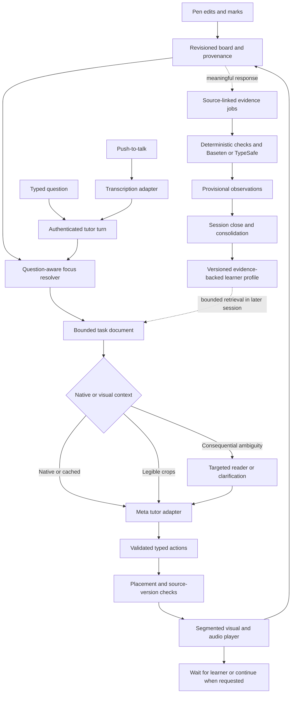

# Y: shared-board tutor architecture

Status: target architecture, 2026-11-01, delivered through the [roadmap](builds/ROADMAP.md).
Planned components are not claims of implemented behavior. [Workflow](workflow.md)
records the current boundary. The old architecture is preserved in
[legacy/learner-adapter-architecture.md](legacy/learner-adapter-architecture.md).

## Interactive path

Use explicit workflow states, not independently chatting agents. Code handles
extraction, selection, layout, authorization and state transitions. Models handle
visual perception, explanation and rubric interpretation.

Four loops at four timescales: the live turn (seconds; the only latency-critical path),
evidence labeling (async per answer), reflection (once per session close) and policy
improvement (offline GEPA). Measured choices for each — model, effort, wire format — are
recorded in [harness decisions](decisions/2026-11-01-harness.md).

## Model routing

| Job | Model |
|---|---|
| Live tutor, board vision, pointing | `muse-spark-1.3`, `reasoning_effort=minimal`, strict JSON moves |
| Voice in | Muse Voice Transcribe (`muse-voice-transcribe-1.0`) |
| Voice out | Kokoro, browser speech fallback (no Meta TTS exists) |
| Evidence labels | Baseten decision model (Elephant default) + deterministic verifiers |
| Session consolidation notes | `meta-models/muse-spark-open-1026` on Baseten, strict JSON |
| Illustrations | `muse-image-1.0`, async |
| Offline judge / GEPA reflection | `muse-spark-1.3` at medium or high effort |

## Contracts and ownership

- **TutorTurn** (planned): request ID, question/transcript, input kind, saved board
  revision, focus hints and prior-turn reference. Server resolves ownership.
- **BoardSource / ContextPacket** (existing): immutable sources, exact text/specs,
  bounded relationships/crops, authorship, assistance and coverage. Extend versioned
  contracts; do not replace them with an untraceable paragraph.
- **Interpretation** (existing): reading, ambiguity and source references, separate
  from original content. A correction appends an attributed record.
- **TutorAction / segment** (planned extension): validated draw/equation/diagram,
  narrate, ask, wait and widget specs. Reuse the primitive protocol internally.
  Segment IDs align narration with visuals and cancellation.
- **LearningEvent / Observation** (planned extension): source, assistance, proposed
  concept, result, uncertainty and model/policy version. Exposure is not success.
- **ProfileRevision** (B08): finalized-session result with supporting observations.
  Keep the subject graph distinct from this learner's evidence overlay.

The browser owns interaction and local recovery. The API owns identity, budgets,
source loading, model calls and durable transitions. Never trust client-selected
owners, grades, profile facts or hashes; enforce ownership on asset retrieval.

## Context selection and fidelity

1. Save pending work; bind the question and recent interaction to that revision.
2. Resolve explicit references, recent annotation targets and connected work. Fall
   back to current view when no stronger signal exists. Regions are optional.
3. Extract exact native text, equations and specs. Include whole strokes, labels,
   arrow endpoints and relevant off-screen context; preserve spatial structure.
4. Send native/cached content directly to the tutor. For visuals, use focused crops
   plus structured context; a separate OCR/reader pass is not mandatory every turn.
5. Permit a bounded focused reading or targeted clarification before explaining a
   consequential uncertain symbol. Do not grade a guessed transcription as verified.
6. Persist normalized interpretations when assessment needs them; they identify
   exact sources and completeness. Do not delay unrelated explanations for this.

Every stateless request receives sufficient current context. Bound prior-turn
summaries and profile facts within an explicit total prompt budget; the 24 KiB
board limit must not leave conversation history unbounded.

Retain 200 detailed elements / 24 KiB and at most two crops per reading call, each
1,600 pixels on its long edge and two million pixels maximum. Allow at most one
focused re-read. Insufficient coverage means incomplete assessment or clarification,
never silent truncation. Preserve the complete scene in storage.

## State, placement and cancellation

Planned states: saving -> preparing -> responding -> playing -> waiting -> done,
with cancelled/failed exits. Clarification returns control to the learner. Initially
allow one active interactive turn per session, with request idempotency.

Check relevant source revisions before applying actions. Referenced-work edits stop
stale output; unrelated edits need not. Cancellation invalidates a turn locally
immediately and propagates upstream. Keep completed model-authored work; discard
pending actions/audio. Stream validated actions without buffering the full lesson.
Layout code reserves response space and protects learner ink from model coordinates.

## Visual and speech tools

Keep Excalidraw for ink/text/static diagrams; reuse KaTeX, primitive validation,
renderer and player. Mermaid from the tutor converts to native Excalidraw elements.
Interactive widgets are typed specs rendered through Excalidraw embeddables (fallback: a
board-anchored overlay), with saved state, touch handling and an export fallback. Widgets
derive their own numbers from small specs so the model cannot supply inconsistent data.
No arbitrary generated HTML/JavaScript; sandboxed model-written sims are deferred. Slider
calculations run locally. Generated images are illustrations only.

Transcription and synthesis are separate adapters. Start with push-to-talk and
segmented speech with Stop/Continue; do not infer hosted TTS or full-duplex voice
support from an ASR endpoint. Visible text remains usable when speech fails.

## Storage and scaling

Retain immutable edit batches, expected-revision conflicts, materialized current
scene, checkpoints, hashed assets and IndexedDB outbox. Existing limits: 5,000 live
elements, 1 MiB batches, 2 MiB images, 32 MiB assets/session. Ordinary loads do not
reconstruct full history. Preserve mixed authorship, imports and semantic metadata.

Use maps/indexes and batched version checks. No inference or repeated full-scene
serialization per stroke. Use short transactions, shared provider clients,
DB-backed claims/budgets, bounded concurrency; never await inference in a transaction.

Target deployment: Vercel web/proxy, Modal CPU API, shared Postgres, hosted models.
Own GPUs and AWS are not prerequisites. SQLite is local-only. An asset interface
allows object storage later without changing board records. Background jobs need
shared leases, idempotency and recovery; in-memory tasks alone are not durable.

Before public deployment verify SSE/timeouts, cold starts, secure cookies, ownership,
migrations and DB pools. Isolate legacy unowned learner endpoints. Guest identity is
not cross-device account recovery. Retention and broader public-service hardening
remain explicit release work; deployment/capacity is not yet verified.

## Adaptation

Before H5 keep `profile_updated=false`. H4 records observations (concept, dimension —
recall, understand, apply, analyze, transfer — outcome, misconception, miss class,
assistance, confidence). H5 consolidates once per finalized session: a deterministic
reducer updates Beta beliefs per concept × dimension, recall half-lives and a misconception
ledger; Muse Spark Open proposes teaching notes that must cite events. A ≤ 600-token brief
is retrieved for the next session; `because` chips must cite brief ids. No per-stroke
grading or online weight training. H10 uses GEPA offline on simulated-learner scenarios,
promoting a versioned pedagogy policy only after held-out evaluation. Never silently mutate
live tutor policy or original learner evidence.

## Study loop and progress representation

Use a small versioned topic-pack registry for concepts/propositions, scoped
prerequisites, tasks, rubrics, verifiers, widgets and review-item templates. Broad
explanations can work outside a pack; verified assessment coverage remains explicit.

Short prediction/retrieval/exit questions capture original answers and assistance
inside the board workflow. A session-end reflection is learner-reported evidence,
not proof of mastery. Consolidation produces suggested teaching notes and due review
items with provenance; retain actual timestamps to distinguish transfer from retention.

Expose the Constellation (3D concept map, lazy-loaded) and a review queue over existing
records, not a separate graph database or ability-scoring service. Distinguish encountered, assisted,
supported and unknown nodes. Open a node to its sources and next suggested task.
Resume entry points list saved sessions and canvases; interrupted work is recoverable.

The selected hackathon implementation, including deployment and verification, must
finish by November 3 at 22:00 IST. The roadmap's dated gates govern scope; optional
visuals/optimization must not consume the final integration block.
