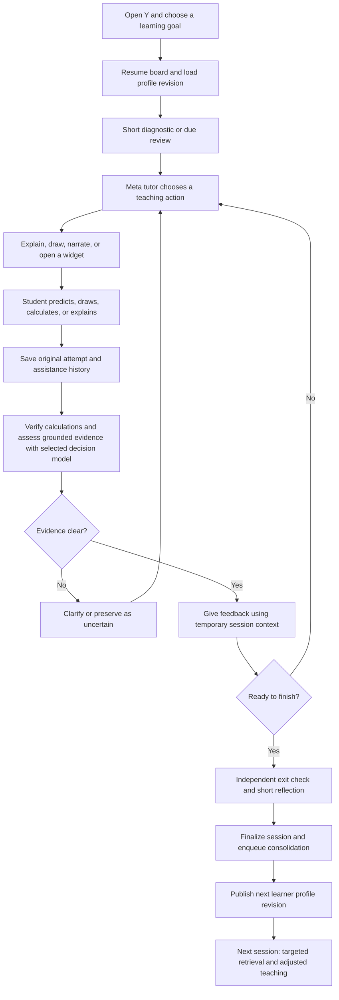
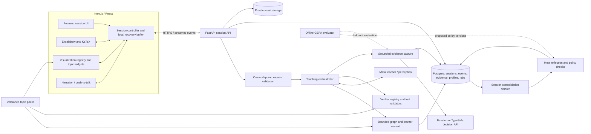
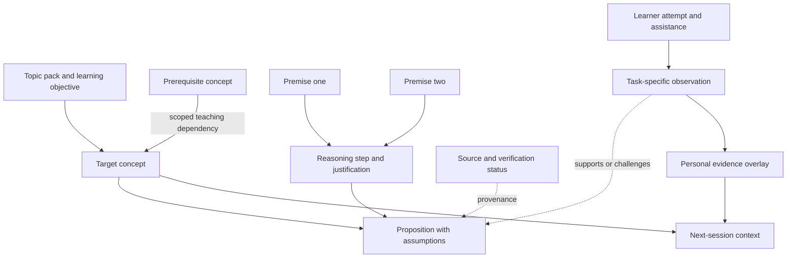
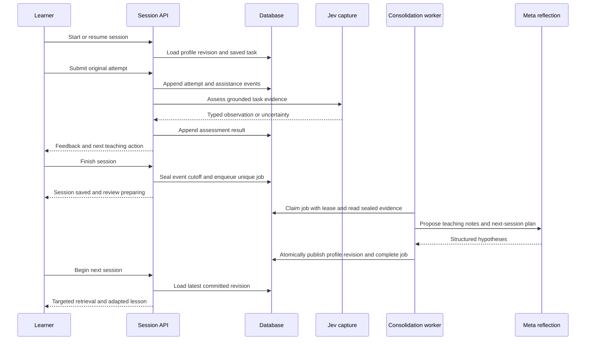

# Y: hackathon architecture and delivery plan

Status: revised initial design for discussion; implementation has not started under this plan.
Revision: subject-independent architecture, advanced demo candidates, explicit GEPA milestones, and reading guide.
Prepared: October 29, 2026. All dates and times below are Asia/Kolkata (IST).

## 1. Product and commitments

**Y is a shared visual tutor that captures evidence of understanding and uses it to teach better in the next session.**

Y is a subject-independent learning application. The initial audience is undergraduate/graduate learners, with computer vision and linear algebra as reference subjects. The user selected computer vision as an area of interest, not convolution as a fixed product scope. An advanced visual demo will exercise the common platform; the final topic remains open.

**Architecture acceptance requires a second topic to run through the same session, evidence, graph, teaching, and consolidation services.** This proves an extension boundary, not equal assessment accuracy across every subject. Avoid topic-specific API routes, database columns, or teaching-state transitions.

Success means a student can do something independently after using Y, return to a saved session, and see a justified change in the next lesson. The submission should make these behaviors visible within three minutes.

Agreed scope:

- Keep Excalidraw and the existing equation/drawing renderer.
- Start with hosted Baseten Elephant for evidence capture, compare Mammoth and Joey on reviewed cases, and keep TypeSafe Jev as an explicitly selectable alternative. Establish faithful capture before trusting persistent adaptation.
- Consolidate durable learner knowledge and teaching notes **between sessions**. Continue responding to mistakes during the lesson using temporary session context.
- Make Meta models central to board perception, teaching, structured actions, and optional speech input.
- Include a reusable interactive visualization registry and one advanced reference experience; introduce their contracts early. Validate a second, smaller topic pack through the same core.
- Build through **November 3**. Reserve **November 4 through submission** for recording, editing, final checks, and narrow fixes.
- Submission deadline: **November 5 at 07:30 IST** (November 4, 21:00 Eastern). Target submission on November 4 evening. [Event schedule](https://cerebralvalley.ai/e/meta-ai-developer-hackathon)

This is a competitive product hypothesis, not a prediction of placing in the top two. Prioritize impact, meaningful Meta use, execution, and a convincing working demo.

## 2. Scope boundaries

### Required

1. A coherent teaching journey: diagnostic attempt, explanation/exploration, learner response, feedback, independent exit check.
2. Decision-model assessments grounded in learner-produced evidence, with abstention and evaluation.
3. Persisted sessions, board/assets, attempts, events, and resumable tasks.
4. Session finalization that updates a versioned learner profile exactly once.
5. A concept/prerequisite graph with a personal evidence overlay.
6. Reusable plotting/visualization support, one advanced demo pack, and a second-topic portability check.
7. Meta-powered teacher and selected-object/board context shared with chat.
8. Narration with stop/replay; text remains usable when speech fails.
9. Separate user-owned data, cancellation, bounded retries, rendering checks, and measured latency.
10. A polished desktop/tablet experience and a usable phone fallback.
11. GEPA evaluation interface and a frozen policy baseline; candidate optimization/promotion depends on the evidence and reliability gates.

### Conditional after the core gates pass

- Push-to-talk with Meta transcription.
- A bounded GEPA experiment on one prompt component.
- Additional diagram templates and a Mermaid conversion path.
- Additional 3D experiences beyond the selected reference pack. If stereo geometry is selected, its bounded 3D camera/ray view is part of that pack, not a late decorative extra.
- Image generation when a lesson needs a visual scenario; exact kernels and plots remain deterministic.

### Defer

Global leaderboards, full exam administration, live collaborative classrooms, autonomous arbitrary HTML generation, general 3D scene generation, custom neural learner training, and self-hosting an unverified Jev alternative. Short checks, mixed practice, reflection, and a review queue cover the study loop for this build.

## 3. Existing code: retain and repair

Inspection found useful implemented foundations, but the README describes a learning loop that the normal frontend currently cannot enter.

- `web/src/lib/api.ts:61` sends `include_checkpoints=false`; `web/src/hooks/useTutorSession.ts:298` ignores lesson checkpoint events. Assessment requires an existing checkpoint. Repair this through the new teaching flow, rather than assume it works today.
- `api/prompts/system.md` demands complete solutions and forbids learner questions within the lesson. Replace that behavior with explicit teaching actions and pauses.
- `api/main.py` updates learner evidence during lesson/assessment handling. Refactor those updates into the session-finalization boundary. Keep current-session feedback temporary.
- `api/learner.py` already has evidence-aware beliefs and concept-linked teaching notes. Retain the useful logic behind a persistence/context interface; do not run unvalidated neural adaptation.
- Do not reuse `record_evidence()` unchanged for capture: `allow_adaptation=False` still permits other durable updates. Introduce a separate append-only capture path and an explicit consolidation reducer.
- `api/teacher.py` provides a teacher protocol worth extending. Remove mandatory local Ollama extraction, reflection, and embedding dependencies from the public Meta path.
- `web/src/components/Whiteboard.tsx` exports a whole-board PNG. Add element authorship and task/attempt references so assessment cannot grade the tutor's own answer.
- Board, transcript, checkpoint, and replay state need durable restoration. Browser identifiers alone do not provide ownership enforcement.
- Keep the parser, SVG sanitization, salvage behavior, KaTeX, lesson player, narration queue, and shared UI controller where they fit the new flow.

Verification already performed in the earlier assessment: frontend suite passed 15 tests. A selected backend test run produced no output before being stopped; backend status is unverified. Existing `.gitignore` and `web/.gitignore` modifications predate this plan.

## 4. Learner workflow



The tutor chooses among diagnostic probe, prediction, hint, worked step, guided exploration, explanation, independent practice, and transfer check. It must wait when learner input is required. A learner can request a full explanation; do not turn every interaction into compulsory questioning.

Use exploration to create a meaningful question, guidance to resolve the obstacle, and retrieval to test what remains available without the explanation. These are instructional behaviors, not separate app modes. Research supports guided discovery and retrieval activity; it does not establish that attractive diagrams alone improve learning. [Discovery review](https://physics.uwyo.edu/~rudim/S14_JEduPsych_DoesDiscoveryLrngEnhance.pdf), [retrieval experiments](https://learninglab.psych.purdue.edu/downloads/2014/2014_Blunt_Karpicke_JEDP.pdf)

## 5. Application architecture



### Subject-independent core and topic-pack contract

The core owns identity, sessions, tasks, evidence provenance, pedagogical actions, graph retrieval, consolidation, and policy versions. A **topic pack** supplies content and capabilities through a small typed manifest. This is a local registry for the hackathon, not a marketplace or a general plugin framework.

```text
TopicPack
  pack_id, version, title, learning_objectives, sources
  concepts, scoped_prerequisite_edges, propositions, reasoning_steps
  task_templates, rubric_ids, misconception_hypotheses
  widget_types, verifier_ids, review_item_templates

TaskSpec
  task_id, pack_id, pack_version, target_concept_ids
  prompt, response_modes, rubric_id, allowed_assistance
  widget_spec?, verifier_id?, verification_scope

WidgetSpec
  widget_id, type, schema_version, parameters, asset_refs
  state, supported_actions, emitted_event_types

VerificationResult
  status: verified | contradicted | unknown | unsupported
  checked_claims, assumptions, diagnostics, verifier_version
```

All routes remain session/task/attempt based. The orchestrator resolves capabilities through registries, without `if topic == convolution` or equivalent branches. Built-in domain code belongs behind verifier/widget interfaces. Use the same append-only evidence envelope across subjects; rubrics choose applicable dimensions. A literature argument need not receive a mathematical score.

A learner may also ask an open-ended question outside installed packs. Support ordinary explanation, drawing, and source-backed discussion; mark generated content as provisional. Where no verifier or evaluated rubric exists, report the assessment's limits and avoid silently granting verified mastery. Broad teaching availability and validated assessment coverage are separate properties.

**Portability gate:** load a second pack with different concepts/rubrics and an existing widget type, then complete an attempt, finalize, and resume a changed next session without editing core routes, reducers, prompts' control logic, or database schema. Subject-specific reference data/verifiers may be added. Confirm no unverified transfer of mastery between superficially similar concepts.

### Hosting and persistence

Retain Vercel for the web application and Modal for the Python API/worker. Prefer a CPU API calling hosted models; benchmark speech before retaining an always-warm GPU. Do not carry the current Gemma GPU deployment forward as a compulsory dependency.

Use one managed Postgres database for transactional state and jobs. Use private object storage for board images/audio and large scene files; store references and hashes in the database. Small board snapshots can initially live in Postgres to avoid blocking on a second storage service. Choose one database provider during the first implementation session; no graph database or Redis is required.

Modal Volumes remain suitable for immutable model/assets caches, not concurrent mutable learner records. Their documented same-file write behavior does not supply database transactions. [Modal Volumes](https://modal.com/docs/guide/volumes)

Use a signed anonymous session with server-derived ownership. Prefer a same-origin frontend API proxy and an HttpOnly cookie; test streaming through the deployment path. Every session, attempt, profile, asset, and deletion checks ownership. Anonymous identity supports a separate browser's return visits; cross-device account recovery can wait.

### Scaling boundaries and deployment decision

**Initial deployment:** Vercel serves Next.js; Modal runs the FastAPI application on CPU and separate background workers; managed Postgres holds durable state/jobs; private object storage holds large assets. The API calls hosted Meta/Jev providers. Hosted inference already includes the provider's GPU infrastructure: it does not require us to provision another GPU. Add a separate Modal GPU worker or Baseten endpoint only for a model we deliberately self-host after benchmarking. Browser-side plots and 3D scenes normally use the learner's device for rendering.

Modal supports FastAPI hosting, configurable autoscaling, and concurrent inputs for I/O-heavy requests. Set bounded concurrency and container limits, rather than relying on defaults. Choose warm capacity from cold-start measurements and budget. [Web Functions](https://modal.com/docs/guide/webhooks), [autoscaling](https://modal.com/docs/guide/scale), [input concurrency](https://modal.com/docs/guide/concurrent-inputs)

**Build these foundations during the existing implementation slices:**

- Keep the API stateless between requests. Durable learner state must survive replacement of any API container; in-memory caches are disposable. Stream-local transient state is acceptable, but completed actions/events need durable IDs for reconnection and deduplication.
- Use one modular backend codebase with separate API and worker entrypoints. Keep Modal deployment wrappers outside teaching/evidence/domain code. Configure provider URLs, secrets, storage, and model choices through environment/configuration; avoid building a universal cloud abstraction.
- Pool database connections with a bounded per-instance pool and an overall connection budget. Use transactions, ownership checks, indexes on owner/session/job lookup fields, and optimistic revisions. Test simultaneous writes to the same session, not just separate users.
- Finalize sessions by recording a durable job transactionally. Workers claim jobs with leases, retry with limits, and apply idempotent results. A scheduled recovery sweep must find abandoned/pending jobs; work cannot depend on an HTTP request remaining open. GEPA runs separately from interactive inference.
- Bound input sizes, concurrent model calls, retries, output tokens, and per-user spend. Provider quotas are shared across API instances: use a shared database-backed admission/budget mechanism initially, not only process-local counters. Return a clear busy/retry response when capacity is exhausted.
- Stream teaching responses and cancel unnecessary upstream work where supported. Validate streaming, timeouts, cookies, and reconnect behavior through the deployed Vercel-to-Modal path. Keep media payloads out of that proxy when size/duration constraints require direct private-storage uploads.
- Record request/job IDs, provider latency, first useful response time, failures, queue age, and approximate cost. Avoid logging raw learner content by default. Place API, database, and storage close together where available.

**Hackathon acceptance:** run a small staged concurrency check (for example 1, 5, then 10 active scripted learners, subject to provider quotas and budget), with realistic streamed responses and session finalization. Verify ownership isolation, no lost/duplicate updates, restart recovery, and latency/cost. Use mocked providers to stress persistence/retries cheaply, plus a small live-provider run to expose quota and streaming limits. Report only measured capacity; this is not a claim of production-scale validation. Schedule the foundations on October 30, worker recovery on November 1, and deployed concurrency checks on November 2–3.

**AWS decision:** no AWS migration is required for the hackathon or automatically required for growth. Revisit hosting when measured cost, sustained traffic, regional/compliance needs, or operational constraints justify it. Standard FastAPI entrypoints, Postgres schemas/migrations, and explicit storage/job interfaces make migration feasible, but deployment, permissions, networking, and job dispatch would still need adaptation and retesting. Defer Kubernetes, multi-region deployment, database sharding, and a microservice fleet.

**Effort:** these foundations are moderate work because they overlap with persistence and reliable session learning already required. The main difficulty is concurrency and recovery correctness, not choosing a cloud. Treat deployment/streaming integration and load checks as explicit tasks within the schedule; a production operations programme would be a separate, substantially larger effort.

### Proposed modules and boundaries

- `api/providers/meta.py`: actual Meta request/stream adapters and model configuration.
- `api/providers/jev.py`: typed Jev client, timeouts, pinned model, raw-result normalization.
- `api/sessions.py`, `api/storage.py`: sessions, optimistic revisions, ownership, events, snapshots.
- `api/evidence.py`: observability, source validation, rubric dimensions, acceptance/abstention.
- `api/knowledge.py`: concepts, propositions, reasoning links, scoped prerequisites, context retrieval.
- `api/consolidation.py`: durable job execution, profile publication, teaching-note hypotheses.
- `api/topic_packs/`: versioned concept/rubric/example manifests and references to supported widgets/verifiers.
- `api/verifiers/`: common verification contract plus subject-specific implementations; geometry or image operators live here, outside orchestration.
- `api/evaluation/`: labeled fixtures, provider comparisons, offline GEPA experiment.
- `web/src/lib/session-protocol.ts`: versioned teaching actions and streamed events.
- `web/src/components/widgets/`: common host, plot/scene components, registry, and error boundary. Subject widgets implement this interface.
- Existing controller/board/player modules remain integration points; split responsibilities as necessary rather than rewrite the whole frontend.

These names are proposed implementation locations, not files that currently exist.

## 6. Decision-model capture: the first gate

**October 30 provider update:** Baseten Elephant, Mammoth, and Joey are implemented through the shared System One contract in `api/learning/decisions.py`. `DECISION_PROVIDER=baseten` is the default; `DECISION_PROVIDER=jev` selects TypeSafe explicitly. The following Jev-specific research remains relevant to the original provider, while the capture/evaluation requirements apply to either. Baseten's documented `-latest` model names are mutable aliases, recorded as such; do not describe them as pinned revisions. No accuracy or latency comparison has run yet. Start with Elephant as a baseline and choose among providers using reviewed cases, not model size alone. [Baseten decision-model contract](https://docs.baseten.co/inference/model-apis/decision-models)

### What is assessed

Keep the user's requested dimensions, expressed as observable performance on a particular task:

- **Conceptual:** explains a target relationship and its assumptions; the pack supplies examples and a rubric.
- **Mathematical procedure:** carries out a calculation/derivation, when the task tests it.
- **Analytical reasoning:** predicts a consequence and connects it to relevant evidence.
- **Critical reasoning:** identifies an invalid assumption, counterexample, or limitation.
- **Delayed retrieval:** recalls or applies a previously studied idea after a recorded delay.

“Memory,” “analytical ability,” and “critical thinking” are not global traits inferred from one answer. Unobserved and not applicable are distinct from incorrect. No retention update merely because the conversation ID changed. For the demo, use a genuinely next-day unaided check; store elapsed time and assistance explicitly.

### Capture pipeline

1. Save the exact learner attempt before feedback, linked to task, board revision, selected region, widget state, and any audio transcript.
2. Separate learner content from tutor content. Store hints/revealed answers as assistance metadata.
3. For handwriting, use Meta perception to propose a transcription. Keep the original crop and source IDs. Ask for confirmation or abstain if ambiguous; a source reference alone does not prove that a transcription is correct.
4. Run numerical checks where available. Jev does not replace exact arithmetic.
5. Give Jev the task rubric, specific source chunks, attempt, and assistance context. Use Choice for supported/contradicted/not-observable/ambiguous; use Score for ordered rubric levels only when observable. Noul can answer narrow evidence-presence questions.
6. Validate returned schemas, source ownership, and permitted labels. Preserve raw results and evaluator versions. Accept, abstain, or queue for review.
7. Append accepted observations now; update the durable learner profile at session finalization.

Pin the tested Jev model (`jev-1.14.0` is documented at research time). Its API returns decisions/distributions; Y must supply and enforce evidence provenance. Choice/Score confidence is a distribution statistic, not an independently validated probability of correctness; Noul has no separate confidence field. [API contract](https://docs.typesafe.ai/api/system-one), [confidence](https://docs.typesafe.ai/confidence)

Use the hosted API initially. No official downloadable Jev weights were verified. Direct image input is explicitly experimental in the feature documentation, so the initial reliable path is grounded textual/structured evidence with original visual sources retained. [Models](https://docs.typesafe.ai/models), [images](https://docs.typesafe.ai/images)

### Application evidence contract

```text
EvidenceObservation
  evidence_id, owner_id, session_id, task_id, attempt_id
  concept_ids, dimension, observation_code, rubric_version
  source_refs: event_id, element_ids/region/text_span, content_hash
  transcription_status: not_needed | confirmed | uncertain
  assistance: hint_ids, solution_revealed, independent_attempt
  result: label/level, probabilities, provider_confidence?
  evaluator: provider, model_version, question_version, raw_result_ref
  status: accepted | abstained | pending_review
  reason_codes, created_at, prior_exposure_at?, elapsed_seconds?
```

This is Y's normalized record, not a claim about Jev's raw JSON schema. Different dimensions may remain unobserved. Preserve probabilities rather than flattening every response into one number.

### Faithfulness gate

Prepare approximately 50 human-reviewed attempts: tuning examples, a validation subset, and a sealed test subset split by task family within the reference subjects. Include correct, partial, mistaken, copied, heavily hinted, unreadable, irrelevant, and absent evidence. Group related attempts to avoid leakage. Include both reference packs and report results per pack/dimension; aggregate precision must not hide failure on the second subject. Revalidate newly added rubrics before treating their assessments as reliable.

Measure accepted-label precision, abstention coverage, confusion by dimension, and probability behavior. With this small set, calibration results are exploratory. Initial engineering targets: at least 90% precision among accepted held-out classifications, useful coverage on clear cases, and zero fabricated/foreign-source acceptance on adversarial fixtures. Report denominators. Choose confidence thresholds on validation data, not the sealed test set. If the gate fails, keep Jev capture in shadow mode and show uncertainty; do not publish misleading mastery.

## 7. Knowledge representation

Use a shared content graph plus a per-user evidence overlay. Store typed records in Postgres and draw a small local map; a dedicated graph database is unnecessary.

- **Concept:** stable ID, name, aliases, definition, domain, version, source.
- **Prerequisite:** concept A prepares for B for a specified learning objective, with a justification and reviewed/proposed status.
- **Proposition:** a precise claim with assumptions, scope, source, and verification status.
- **Reasoning step:** a node joining all required premise propositions to a conclusion, with its justification.
- **Personal evidence:** attempts and observations linked to these records; derive support, uncertainty, misconceptions, and review dates.

Semantic similarity can suggest a concept match; it cannot establish a prerequisite. Require a DAG for a particular lesson's prerequisite plan, while allowing cycles in general related-to links. New model-proposed content/edges remain proposed until checked; seed the reference packs manually. Namespace concept IDs and version their definitions. Reuse a concept across packs only when its meaning and scope match; transfer evidence through reviewed mappings, never just matching names.

LearnHarness's proposition/reasoning provenance is useful here, but its content graph deliberately excludes understanding assessments. Preserve that separation. Review AGPL obligations before copying source; this plan calls for our own narrow contracts. [Graph contracts](https://github.com/amosblomqvist/learnharness/blob/main/src/core/contracts/graph.ts), [plan tool](https://github.com/amosblomqvist/learnharness/blob/main/src/agent/tools/plan.ts), [license declaration](https://github.com/amosblomqvist/learnharness/blob/main/package.json)



The map shown to a student should distinguish encountered content, supported understanding, assisted performance, and unobserved areas. A populated node is not proof of mastery.

For each turn, retrieve the target, its direct prerequisites, relevant reasoning, current widget state, and a few recent/contradictory observations. Start with a budget of roughly 8–12 nodes and 5–8 observations; tune the token budget against performance. Expand another hop only when diagnosis warrants it. Do not inject the entire graph into every prompt.

## 8. Session learning and job recovery



Session states: active, paused, finalizing, finalized. Jobs: pending, running, succeeded, retryable-failed. Use unique finalization IDs, event cutoffs, leases, bounded retries, and compare-and-swap profile revisions. Duplicate clicks/retries must not add evidence twice. If two sessions finish concurrently, merge their distinct sealed evidence through a serialized per-user update rather than overwrite one revision.

The worker must be backed by the jobs table and recover after process restart. Do not rely solely on an in-memory background task. A session opened while consolidation is pending can use the latest committed profile with a visible preparing status; saved work remains available. An interrupted session is recoverable, not automatically completed or treated as mastery.

Teaching notes begin as hypotheses with source evidence and outcome links. Reuse relevant notes, record the next independent outcome, and revise/discard unsupported notes. Freeze the promoted policy version within a session. Keep live conversational context separate from durable profile publication.

## 9. Advanced reference demos and reusable interactivity

### Selection: advanced goal, adaptive prerequisite depth

Choose one flagship by the end of October 30 using a small prototype. An advanced topic should reveal a useful misconception, support a compelling manipulation, and admit a meaningful independent check. Subject prestige alone does not establish product value. Diagnose prerequisite gaps locally rather than forcing everyone through elementary lessons.

**Recommended candidate: stereo depth and triangulation.** Show two cameras, a movable 3D point, image-plane projections, and rays. Let the learner change depth or camera baseline, predict disparity, and inspect reconstruction sensitivity. Connect linear algebra, perspective geometry, and 3D vision. This is an advanced teaching example; do not describe a classical geometry widget as a state-of-the-art learned reconstruction model. A university SfM/NeRF project provides a useful curriculum reference. [WPI vision project](https://rbe549.github.io/spring2024/proj/p2/)

**Deep-learning alternative: vision-transformer patch attention.** Inspect image patches, a selected token's attention weights, and representation changes for a small pretrained model or a transparently labeled cached run. Label layer/head/normalization and model identity. Attention weights are not automatically explanations of causal importance. Live model inference, tensor extraction, caching, and interpretation checks make this a larger build; choose it only if the initial prototype is reliable. [Stanford CS231n curriculum](https://cs231n.stanford.edu/2025/schedule.html)

**Linear-algebra reference: eigenvectors and PCA.** Manipulate a transformation or rotate a projection through a point cloud; connect invariant directions, variance, and reconstruction. This is a strong alternative flagship and a smaller second-topic validation pack. Start the portability check with matrix transformations/eigenvectors; add PCA only if useful. [Visual eigenvector lesson](https://www.3blue1brown.com/lessons/eigenvalues/)

Convolution and kernel arithmetic remain optional prerequisite content and convenient numerical fixtures. They no longer determine the main user journey, service names, or delivery milestones.

### Common visualization interface

Build a registry for `line_plot`, `scatter_plot`, `heatmap`, and a bounded `scene_3d` when required by the selected pack. Widgets declare state schemas, supported tutor actions, semantic learner events, and save/restore behavior. Specialized camera/attention/matrix widgets compose these capabilities. Add new types through the registry; do not introduce topic branches in the session controller.

Use custom React/SVG for precise small constructions and a client-only Plotly bundle where scientific plotting is useful. Keep imports lazy, cap arrays, label axes/units, and handle WebGL failure. Browser interaction updates locally, without an LLM call per drag. Persist meaningful parameter commits plus the learner's prediction/explanation. A slider change alone is not evidence of understanding. [Plotly React integration](https://github.com/plotly/react-plotly.js/blob/main/README.md), [chart events](https://plotly.com/javascript/plotlyjs-events/)

Initially open a focused widget panel linked to an Excalidraw anchor. Preserve its semantic state and references when closing, panning, or reopening. A live overlay is optional after reliable selection and restoration. The tutor issues validated specifications/actions, never arbitrary executable widget code. [Excalidraw integration API](https://docs.excalidraw.com/docs/@excalidraw/excalidraw/api/props/)

### Two-session demonstration, instantiated for stereo geometry

Session 1: ask whether a farther point produces larger or smaller disparity under fixed rectified camera geometry. Capture the learner's prediction and reasoning. If needed, inspect the similar triangles or projection equations with the same visual scene. Manipulate the point, then ask an unseen configuration without showing the prior answer.

Session 2: retrieve the previous misconception and uncertainty, check the relation unaided, then change baseline or introduce measurement noise. Ask the learner to predict the effect and explain when reconstruction becomes unreliable. Record actual elapsed time; same-day transfer is distinct from delayed retrieval.

The same abstract flow applies to eigenvector direction or attention normalization: retrieve evidence, choose a teaching action, observe an independent attempt, then consolidate. Task wording, diagrams, rubrics, and verifiers come from the pack.

### Pack-specific verification examples

- **Rectified stereo:** for focal length in pixels, baseline/depth in consistent length units, and positive depth, disparity follows `d = f B / Z` under the stated convention. Doubling depth halves disparity; doubling baseline doubles disparity. Guard zero disparity, points behind a camera, and inconsistent coordinate conventions. Check reprojection residuals; illustrate that depth error grows at small disparity.
- **Linear algebra:** verify `Av ≈ λv` with declared tolerance, accept nonzero scalar multiples/sign changes, and handle repeated eigenvalues. For PCA, distinguish centered data, unit directions, variance, and reconstruction error.
- **Attention option:** verify tensor shapes, the selected layer/head, masked positions, and row normalization where softmax applies. Do not turn a visually plausible heatmap into a claim of explanation fidelity.
- **Convolution prerequisite, if retained:** verify kernel flipping, signed output, padding, and stride using deterministic fixtures. [PyTorch operator definition](https://docs.pytorch.org/docs/2.14/generated/torch.nn.Conv2d.html)

Shared tests cover widget lifecycle, serialization, unsupported actions, stale revisions, and failures. Pack tests check domain correctness. Use original or properly licensed inputs, with provenance.

## 10. Model harness and failure behavior

Meta Spark is the initial teacher/perception candidate; compare a more capable Meta model only where measured errors justify it. Meta Voice Transcribe is optional speech input; it does not supply speech synthesis. Reuse reliable narration with browser-speech/text fallback. Meta Wonder is a candidate offline reflection model. Baseten's Meta open-weight endpoint is an optional evaluated alternative, not an assumed equivalent fallback. [Meta capabilities](https://dev.meta.ai/docs/models)

The orchestrator owns state transitions, tool validation, turn budgets, and pauses. The model proposes actions. Action contracts include target concept, board patch/widget parameters, learner prompt, and expected evidence; server validation checks IDs, dimensions, limits, and legal transitions before execution. Preserve the current drawing protocol behind an adapter during migration.

Initial proposed endpoints: create/get session, save versioned scene, append events, submit attempt, streamed tutor turn, finalize session, poll finalization, and fetch learner graph/review. Prefer one versioned session API over additional independent state in `/lesson`, `/assess`, and `/chat`. Existing routes can wrap the new services while compatibility is needed.

Failure behavior:

- Unreadable board: ask for clarification; preserve the attempt.
- Jev unavailable/uncertain: mark pending/abstained and continue teaching without changing durable beliefs.
- Tutor timeout: retain partial work and offer retry; never silently mark the task complete.
- Invalid board/widget command: reject, attempt one bounded repair, then show a readable text/equation fallback.
- Speech failure: keep text and controls usable; cancel queued speech on stop.
- Plot/WebGL failure: recover to 2D/static output; keep numerical values accessible.
- Save failure: retain a local recovery buffer and show unsaved status; acknowledge a save only after server confirmation.

Do not switch providers midway through a partially applied turn without an event boundary and deduplication. Keys remain server-side. Remove local teacher/embedding startup requirements from the hosted teaching path.

## 11. GEPA: explicit system-improvement workstream

GEPA is included explicitly. It improves the shared teaching/reflection policy through evaluated prompt changes; the session-consolidation loop personalizes a learner's profile and teaching notes. Both matter, but they have different inputs and promotion criteria. Neither requires changing the base model weights.

Deliverables and timing:

- **October 29–30:** define the evaluator contract, trace schema, human-reviewed cases, and frozen baseline policy alongside Jev capture.
- **November 1:** collect cross-session traces from both reference packs, keeping test families held out.
- **November 2:** run a capped optimization experiment on session-reflection/next-action selection if capture and the live journey pass their gates.
- **November 3:** compare baseline and candidate per pack, record the result, and promote or retain the baseline. An inconclusive experiment is a valid result; do not imply deployed optimization when none passed.

The capture evaluator, promotion guard, and baseline identifier are implemented in `api/learning/evaluation.py`; fourteen seed cases remain unreviewed engineering fixtures. This is groundwork, not a GEPA integration or teaching-policy evaluator. The GEPA adapter, teaching/reflection traces and scoring, optimization run, and deployment remain gated work. Keep raw evidence and shared content truth immutable. GEPA runs outside active lessons, and a promoted policy version stays fixed within a session.

Current GEPA supports a custom evaluator through `optimize_anything`; existing Python services can supply scores and diagnostic feedback without a full DSPy migration. Pin the version tested at implementation time. Use a small call/time/spend cap, preserve all candidates, and compare a frozen baseline against the candidate on unseen task families. [GEPA quickstart](https://gepa-ai.github.io/gepa/guides/quickstart/), [paper](https://arxiv.org/abs/2507.19457)

Evaluator checks: evidence faithfulness, appropriate pedagogical action, factual correctness, premature answer disclosure, schema validity, cost, and latency. Use human-reviewed labels and pack-specific deterministic checks. Report per-pack regressions and transfer to held-out task families; optimizing one demo must not silently worsen other subjects. Jev's own predictions cannot become ground truth for improving Jev. Promotion requires improvement without provenance or correctness regression; rollback stays available. Skip deployment of the optimized policy if results are inconclusive.

## 12. UI and execution targets

Board first; one obvious next action; a compact goal/progress indicator; contextual question controls; a focused widget panel; collapsed chat; visible voice stop/replay. Use restrained glass effects on floating chrome, with solid/high-contrast content surfaces. Keep model/provider/debug controls out of the learner's default flow.

The knowledge map is a small local explanation of progress: selecting a node shows the relevant attempt, assistance, uncertainty, and next review. Avoid a decorative global graph that crowds out studying.

The following are **proposed engineering acceptance targets, not measured performance**:

- Warm teaching turns: first useful text/board action p50 ≤3 seconds, p95 ≤8 seconds on a declared benchmark.
- Jev text assessment: record provider latency separately from transcription; provisional p95 goal ≤1.5 seconds, with a bounded timeout and nonblocking fallback.
- Widget/slider interactions: local visual response within 100 ms on the demo device; no API call per drag.
- Saved state survives reload; resume restores task, board files, widget, transcript, and profile revision.
- Zero critical numerical errors on each supported pack’s fixed verification suite and zero uncaught rendering errors across at least 20 rehearsed task flows.
- Two different owners cannot read/change each other's data. Duplicate/reordered events and repeated finalization do not corrupt state.
- Test normal and poor network behavior. Measure a small three-user concurrency case; publish capacity honestly.

Report sample sizes, warm/cold conditions, device/network, and failures. A clean test run cannot guarantee absence of all failures. Instrument request ID, session/turn/attempt IDs, provider/model/policy version, render errors, latency stages, token usage, and retry counts without logging secret keys.

## 13. Delivery schedule and daily exit gates

Six development dates remain: October 29–November 3. Work in thin complete journeys; review the running product at the end of each day. Start UI work alongside the first live path. Do not spend multiple days building isolated backend infrastructure before trying it through the interface.

### October 29 — Jev evidence and Meta preflight

Implementation update: the first capture slice is on `feature/session-learning-capture`; see [setup and boundaries](docs/learning-capture.md) and [contribution log](docs/hackathon-contributions.md). Typed answers, source receipts, numerical checks, Jev shadow assessment, transactional storage/recovery, a Practice panel, two reference packs, and the offline evaluation boundary are implemented. Live Jev/Meta checks await credentials; human-reviewed faithfulness evaluation, advanced visualization prototypes, and eligibility confirmation are still outstanding. Persistent next-session adaptation remains the November 1 milestone.

- Confirm access to Jev, Meta, database, and deployment; verify pinned request contracts with tiny smoke calls.
- Establish the task/attempt/source/evidence schemas and first manually checked fixtures for two reference packs. Define generic topic/task/widget/verifier contracts and the GEPA baseline/evaluator interface.
- Build the Jev capture adapter and deterministic weighted-sum reference; preserve raw observations.
- Connect one typed learner answer to a visible accepted/uncertain assessment in the existing UI.
- Establish latency/cost logging and diagnose the existing backend-test startup problem.
- Choose seed concepts, prototype the advanced demo candidates, and draft the visual layout. Clarify Indie eligibility for extending the existing codebase; preserve a dated baseline and event contribution log.

**Exit:** one exact attempt can be captured, traced to its source, assessed or abstained, and inspected. No persistent mastery claim yet. If API access fails, keep captured fixtures and provider interface; do not fabricate outputs.

### October 30 — Saved sessions and one real teaching loop

Implementation status: `feature/board-context` now adds saved scene revisions/assets, edit attribution, automatic Practice regions, bounded context/crops, on-request Meta perception, provisional board assessment, and a structured-context bridge to existing teaching providers. Automated checks passed (118 backend, 32 frontend, lint/TypeScript/build); browser smoke, live provider fidelity, and Postgres runtime verification remain outstanding. See [board setup and boundaries](docs/board-context.md). The broader Meta teaching redesign and session consolidation remain subsequent work; `profile_updated` stays false.

- Add transactional ownership, sessions/events, scene restoration, task/attempt identities, and idempotency.
- Tag board authorship; bind typed/voice/board answers to the same task.
- Add Meta teacher behind the provider boundary; remove compulsory Ollama work from the live hosted path.
- Replace solution-first behavior with typed teaching actions and a learner-input pause.
- Connect diagnostic → explanation → independent answer → feedback in the UI.
- Build out the capture fixture set across both packs and run the first held-out check. Choose the flagship based on a small interaction prototype; preserve the second pack as a portability gate.

**Exit:** a Meta lesson and learner attempt survive refresh; assessment uses only the learner attempt; provider failure preserves work. Deploy a usable early slice.

### October 31 — Visualization platform and advanced reference lesson

- Ship the common widget host and reusable plotting/scene contracts with the selected advanced reference lesson.
- Add the smaller linear-algebra reference through the same registry; avoid a second elaborate demo.
- Run pack-specific numerical fixtures and shared save/restore tests. Confirm neither subject requires core API or reducer changes.
- Apply the main desktop/tablet visual design; keep text controls usable on phones.
- Complete Jev validation/abstention tuning using validation cases only.

**Exit:** the learner predicts, manipulates, explains, and gets grounded feedback in one integrated lesson. Capture a baseline screen recording for review, not the final submission film.

### November 1 — Cross-session learning and knowledge map

- Implement finalization jobs, sealed evidence, profile revisions, retries, and restart recovery.
- Load versioned concept/prerequisite/proposition graphs from both packs and attach the same personal-evidence overlay.
- Build bounded context retrieval, teaching-note hypotheses, and next-session review.
- Collect policy-evaluation traces from both packs. Run session one with a few volunteer learners if available; arrange next-day checks.
- Show what evidence changed the next lesson, with assisted versus independent performance visible.

**Exit:** session two starts differently because of valid session-one evidence; repeated finalization has no duplicate effect. If capture fails its gate, keep uncertain dimensions out of the profile and fix the gate before broadening scope.

### November 2 — Voice, pilot feedback, and reliability

- Stabilize narration, cancellation, replay, and optional push-to-talk; verify deployment/browser support.
- Perform actual delayed checks from prior-day sessions and collect product friction observations.
- Measure correctness, rendering, save/resume, concurrency, latency, and cost on the deployed build.
- Run the bounded GEPA experiment only if the main journey is healthy.
- Add extra visual experiences only after required gates pass. Finish the bounded 3D view if it is required by the chosen flagship; cut unrelated 3D/image-generation extras.

**Exit:** deploy a complete release candidate. List measured results and remaining defects. No critical correctness, ownership, persistence, or rendering issue remains open on the demo path.

### November 3 — Final building and feature freeze

- Resolve defects, strengthen low-confidence capture, polish navigation and the learning map.
- Exercise the whole two-session story with fresh data and a second browser/user.
- Run relevant backend/frontend tests, lint/type checks, build, and browser end-to-end checks.
- Verify public repository access, contribution boundaries, attribution, deployment quotas, and live-product availability.
- Prepare the three-minute narrative, shot list, and evidence screenshots. Freeze features by **22:00 IST**; allow narrow fixes afterward.

**Exit:** a reproducible demo, a tagged release candidate, a backup of the working deployment configuration, and a concrete recording script.

### November 4 — Record, edit, verify, submit

- Morning: record the actual working product and a genuine cross-session example; record voiceover and backup takes.
- Afternoon: edit to three minutes; show the problem, learner action, Meta-driven visual teaching, faithful capture, and changed next session.
- Label any pre-recorded earlier session or replay accurately. Do not stage a profile update as a measured learning result.
- Evening: verify accessible video/repository/product links, submission fields, new-work description, and acknowledgments. **Target submission by 21:00 IST on November 4**, retaining overnight deadline margin.
- Keep the live demo available through judging, with budgets and a clear maintenance plan.

**Hard deadline:** November 5, 07:30 IST. Use remaining time for submission recovery and narrow fixes, not new features.

## 14. Gates and cuts when time slips

Critical path: grounded Jev capture → persisted attempt/teaching loop → portable interactive lesson → idempotent consolidation → changed next session → reliable deployed demo.

Protect those gates. Cut in order: additional 3D experiences, image generation, packs beyond the two acceptance references, GEPA deployment, push-to-talk, decorative animation, expanded knowledge-map navigation. Keep typed interaction, reliable narration/text fallback, one advanced interactive experience, the small second-topic portability check, faithful assessment, saved sessions, and cross-session adaptation.

If Jev is inaccurate, improve source capture and rubric first. If still unreliable, expose uncertainty and preserve evidence; do not substitute confident-looking scores. If the widget is unstable, narrow parameters and supported input sizes before cutting interactivity. If a provider is slow, shorten turns and move reflection off the live path before weakening verification.

## 15. Evaluation, resources, and submission story

Required evaluation groups:

1. **Domain correctness:** each pack’s verification fixtures and assumptions; generic core tests must not depend on the flagship.
2. **Portability:** a second pack completes the same flow without changes to core routes/state/schema.
3. **Capture faithfulness:** source isolation, ambiguous input, hints/copying, no-evidence cases, held-out judgments.
4. **Learning behavior:** a prior misconception changes the next session; an unsupported hypothesis does not become a fact; delayed retrieval uses real time.
5. **State/recovery:** refresh, connection loss, retries, concurrent finalization, worker restart, and ownership.
6. **Experience:** perceived waiting, reading/drawing legibility, voice interruption, and plot performance.

Tiny pilots provide usability and near-term transfer evidence, not a causal claim of long-term educational efficacy. Keep baseline versus improved-policy comparisons separate from human learner outcomes.

Available credits as reported by the user: Modal about $150, Baseten $100, Meta $150. Prefer Baseten's hosted decision models if the credit grant covers these Model API calls; TypeSafe Jev remains an alternative with separate access/billing. Baseten inference is paid, not indefinitely free. Before experiments, set per-provider spend ceilings and keep a reserve for recording and judging. Bound GEPA by calls/time/spend. Do not start large self-hosted open-weight serving or training merely to use credits. Use Meta Standard mode for actual learner material; Contributor mode permits training use of content. [Meta pricing/modes](https://dev.meta.ai/docs/pricing-rate-limits)

Three-minute narrative target:

- 0:00–0:20: the problem—following a solution can feel like understanding.
- 0:20–1:20: a learner predicts and explores an advanced visual concept with Meta visual teaching and narration.
- 1:20–1:50: show a specific attempt, Jev's grounded observation, and what remains uncertain.
- 1:50–2:35: a later session retrieves the relevant evidence, changes teaching, and asks an independent transfer question.
- 2:35–3:00: who benefits, measured reliability/limitations, and what was built during the event.

Keep the eligible event contributions explicit. The saved participant guide's existing-code exception specifically mentions startups; Indie eligibility for extending Y needs organizer clarification. Do not claim a model count or a broad feature list as the product's impact.

## 16. Immediate next implementation slice

After reviewing this design, implement the October 29 slice: topic/task/attempt/evidence contracts, small fixtures from two subjects, hosted Jev capture, a Meta smoke request, and one visible assessment with preserved provenance. Then evaluate the capture gate before publishing durable learner updates.

Research limitations: this plan combines source inspection, official documentation, and design recommendations. No Jev/Meta calls, GEPA optimization, latency benchmark, student study, or new application implementation was performed while writing it. Source contracts and deployment details must be smoke-tested during implementation.


## 17. Focused reading and watching for the builder

These are recommended time boxes, not source durations. Spend roughly 60–90 minutes on the first three; use the topic resources only to choose and validate the demo. Reading should produce design decisions or evaluation examples, not delay the first implementation slice.

1. **Learning experience — Andy Matuschak, [How Might We Learn?](https://andymatuschak.org/hmwl/).** Allocate 20–30 minutes. Look for how learner agency, meaningful activity, and support fit together. Write down two interactions Y should enable and one behavior it should avoid. His [Why books don’t work](https://andymatuschak.org/books/) is optional supporting reading about designing learning media.
2. **Faithful capture — TypeSafe [Primitives](https://docs.typesafe.ai/primitives) and [Confidence](https://docs.typesafe.ai/confidence).** Allocate 15–20 minutes. Draft five narrow questions about actual student work, with a not-observable outcome. Distinguish a rubric level, a decision probability, and empirical assessment accuracy.
3. **System improvement — [GEPA paper](https://arxiv.org/abs/2507.19457) and [quickstart](https://gepa-ai.github.io/gepa/guides/quickstart/).** Allocate 25–35 minutes to the abstract, method, one worked example, and evaluator interface. Decide what a better next-session teaching action means and how to score it without using the system's own answers as truth. The authors' [Learning, Fast and Slow](https://gepa-ai.github.io/gepa/blog/2026/05/11/learning-fast-and-slow/) is optional perspective, not evidence that Y improves human learning.
4. **Linear-algebra visual teaching — 3Blue1Brown, [Eigenvectors and eigenvalues](https://www.3blue1brown.com/lessons/eigenvalues/).** Watch the embedded lesson or read its visual treatment. Note how transformations, invariant directions, and prerequisite knowledge are connected. Propose a prediction the learner could make before an animation runs; do not simply copy the presentation.
5. **Modern deep learning — Stanford Online, [CS231n Lecture 8: Attention and Transformers](https://www.youtube.com/watch?v=RQowiOF_FvQ), with [course slides/schedule](https://cs231n.stanford.edu/2025/schedule.html).** Use the relevant self-attention sections if considering the ViT demo. Identify one inspectable computation and one misconception, rather than attempt the full course. The public video was verified through search metadata; direct retrieval was rate-limited.
6. **3D vision — WPI, [Buildings built in minutes: SfM and NeRF](https://rbe549.github.io/spring2024/proj/p2/).** Read the epipolar geometry, camera pose, and triangulation sections selectively. This is a course project, not a requirement to implement SfM or train a NeRF. Sketch the camera/ray interaction and list its coordinate assumptions.
7. **Harness implementation — LearnHarness [plan tool](https://github.com/amosblomqvist/learnharness/blob/main/src/agent/tools/plan.ts) and [graph contracts](https://github.com/amosblomqvist/learnharness/blob/main/src/core/contracts/graph.ts).** Optional 15-minute code skim. Focus on validated prerequisites and reasoning provenance. Keep encountered content separate from demonstrated understanding.

The most valuable user contribution is a small set of real misconceptions and graded attempts from subjects you know well. Supply examples of a convincing-but-wrong explanation, a partially correct answer, a correct answer with weak reasoning, and an independent transfer answer. These directly improve the capture rubric and demo authenticity.
