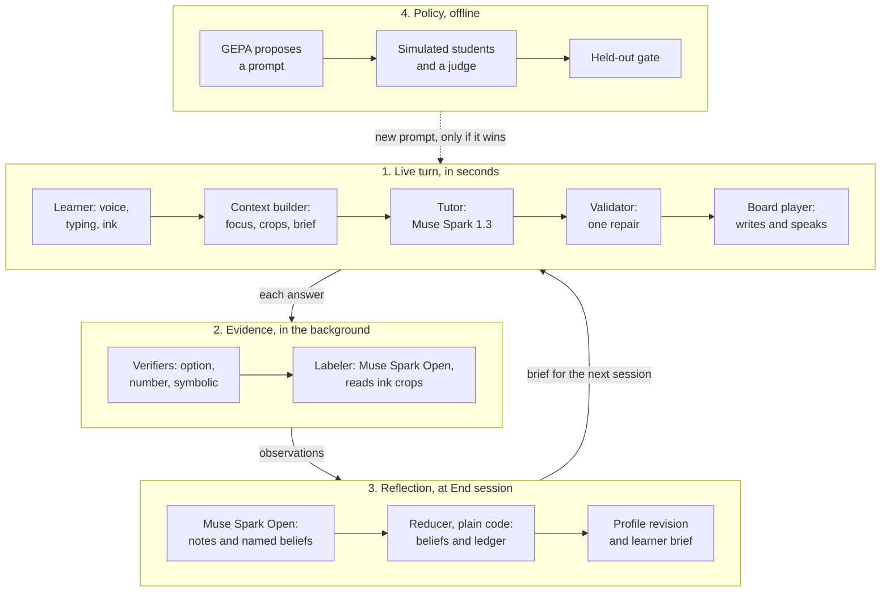
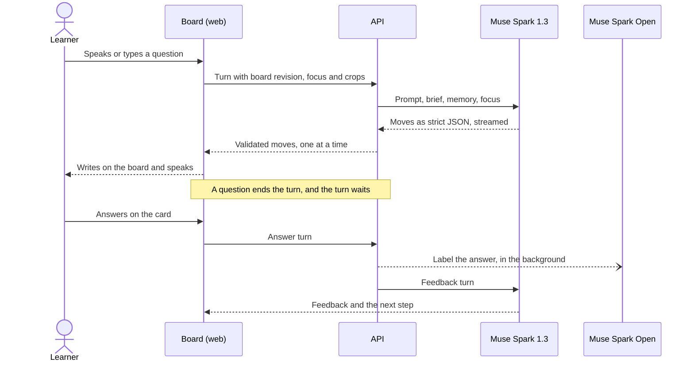
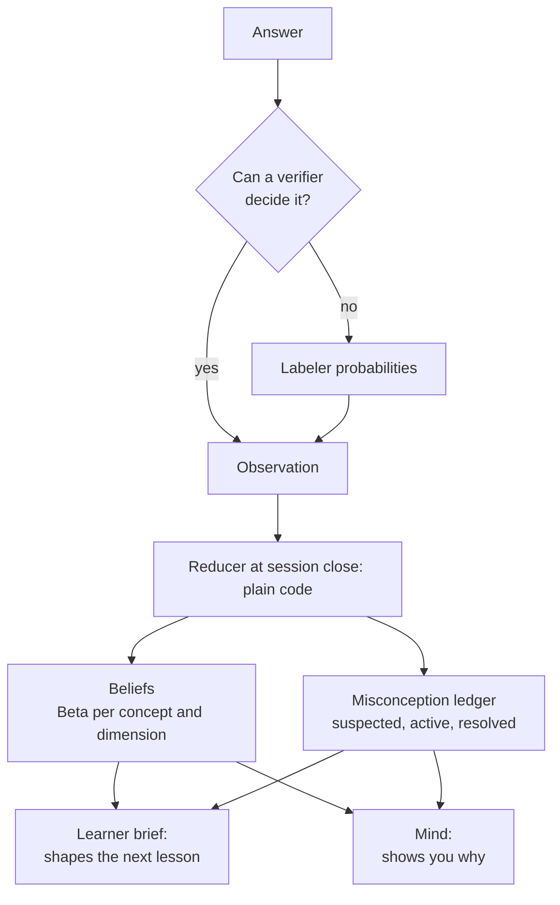
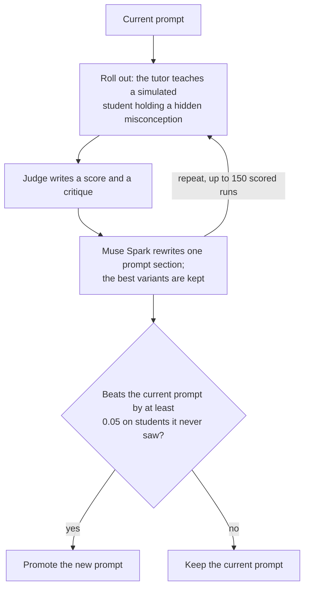

# Y: a whiteboard tutor that learns how you think

Ask Y anything by typing or speaking. It teaches on a shared whiteboard, checks your understanding as it goes, and keeps a model of what
you know and which wrong beliefs you hold. The next lesson starts from that model, and you can open it to see exactly why.

Built for the Meta Global AI Developer Hackathon on Meta's models: Muse Spark, Muse Spark Open, Muse Voice Transcribe and Muse Image.

**Live demo:** <https://ask-y-event.vercel.app/app>

<!-- SCREENSHOT: docs/images/board-lesson.png -->

**Contents:** [Why Y](#why-y) · [Run it](#run-it) · [Try this](#try-this) · [How it works](#how-it-works) ·
[The learner model](#the-learner-model) · [GEPA](#gepa-improving-how-y-teaches) · [Models](#meta-models-used) ·
[Measurements](#what-we-measured) · [Before and during the event](#what-existed-before-and-what-was-built-during-the-event) ·
[Repository map](#repository-map) · [Limits](#limits) · [Troubleshooting](#troubleshooting)

## Why Y

Most AI tutors are answer engines: they explain, you nod, and nothing is remembered. Y works differently in three ways.

- **It teaches where you think.** Lessons are written on an editable board beside your own work, with equations, diagrams and
  interactive widgets, one step at a time.
- **It treats a wrong answer as evidence.** Each answer becomes a labeled observation. Y tracks what you know with honest uncertainty, and
  gives wrong beliefs a name, backed by the answers that show them.
- **It shows its reasoning.** A chip on the board says why a lesson starts where it does, **Mind** shows the evidence behind every belief, and
  **Trace** shows which model did what and how long it took.

## Run it

You need [Node 20+](https://nodejs.org/), [git](https://git-scm.com/downloads) and [uv](https://docs.astral.sh/uv/getting-started/installation/)
(uv installs a supported Python if you need one). The commands are the same on Windows, macOS and Linux.

```bash
git clone https://github.com/Abhijithreddydasari/ask-Y.git
cd ask-Y
npm run setup
```

Put your two keys in the new `.env` file:

```text
MODEL_API_KEY=your Meta key
BASETEN_API_KEY=your Baseten key
```

Start the API and the web app in two terminals:

```bash
npm run api
```

```bash
npm run dev
```

Open <http://localhost:3000/app>. No other key or setting is needed.

## Try this

1. Ask a question, for example "why does attention use a softmax?". Y draws the lesson and asks you something.
2. Answer it wrongly on purpose, in words: "it evens the scores out so every token gets the same weight".
3. Press **End session** in the Places menu. Y seals what it learned about you.
4. Open **Mind** to see the belief it recorded and the answers behind it.
5. Open **Trace** to see each model call and its latency.
6. Ask about the same topic again. The new lesson starts from what you got wrong.

To skip straight to a learner with weeks of history, open **Settings → Try as…** and pick Priya, Tomás or Amara. Each is a private copy,
labelled as seeded, built through the real capture and close path.

<!-- SCREENSHOT: docs/images/check-card.png -->

## How it works

Y runs four loops on four timescales. Only the first is on the clock, so the slower thinking never makes a learner wait.



| Loop | When | What it does | Models |
|---|---|---|---|
| **Live turn** | Seconds | Streams validated moves onto the board | Muse Spark 1.3, Muse Voice Transcribe, Muse Image |
| **Evidence** | Background, per answer | Grades and labels each answer; failures never reach the lesson | Muse Spark Open |
| **Reflection** | At End session | Seals one profile revision, with cited notes and named beliefs | Muse Spark Open; the numbers come from code |
| **Policy** | Offline | Proposes prompt changes and tests them on students it never trained on | Muse Spark 1.3, Muse Spark Open |

### One turn

Each tutor call is stateless and receives one bounded context packet: the system prompt, the learner brief, session memory, the board
focus with up to two image crops, and this turn. The reply is strict JSON, streamed, so each move appears on the board as soon as it arrives.



**What the tutor can do on the board**

| Move | What the learner sees |
|---|---|
| `seg`, `write`, `equation` | A titled step, handwritten text, KaTeX maths |
| `diagram` | A flowchart or sequence that becomes editable board shapes |
| `widget` | Live `plot`, `attention`, `matrix` and `stepper` widgets, with sliders that run in the browser |
| `image` | A Muse Image illustration that arrives shortly after |
| `say` | Spoken narration, with captions, that follows the writing |
| `predict`, `check` | A question card: tap, type, speak, or answer in ink |
| `because` | A chip citing a real item from your profile; one that cites anything else is dropped |
| `point` | A ring around the exact line of your handwriting that went wrong |

**Study loop.** A warm-up re-asks checks that are due, with no model call. A hint ladder goes from nudge to step to reveal, and using it
counts as assistance. End session offers an exit ticket. **Canvases** reopens saved boards.

## The learner model

Y separates **what a model judges** from **what code concludes**. Models label and name; plain, tested code does the arithmetic.



- **Observation.** One per question, keyed on session and question, with its source and provenance: outcome and misconception probabilities,
  miss class (cue, discrimination, execution, careless, structural) and reasoning quality. Deterministic verifiers run first, and a key audit
  catches a wrong answer key from the tutor.
- **Beliefs.** A Beta distribution per concept and dimension. Each answer moves it by expected credit, `p(correct) + ½ p(partial)`, weighted by
  answer format, trust in the answer key, and whether a hint was used. Beliefs decay between sessions on a half-life that grows with spaced
  recall.
- **Misconception ledger.** An answer adds `p(misconception) × p(miss) × weight`. An entry appears as *suspected* at 0.15 and becomes *active* at
  0.5. It is *resolved* only after two answers' worth of clean credit.
- **Naming.** At close, Muse Spark Open groups flagged answers by the belief behind them and names it. A name must cite the answers it rests on,
  and it can only merge into beliefs that really exist in your profile, so a model error can miss a merge but cannot invent an entry. A single
  bare number is held back, because it is usually a slip rather than a belief.
- **Brief.** Compiled by code, with no model call: at most 24 items and 2,400 characters, and each turn holds only items about its topic. Every
  item cites evidence. With **Memory off**, the tutor reads nothing from earlier sessions.

**Mind** draws all of this as a 3D brain-like map you can search, filter and replay, revision by revision. Each neuron opens to the
evidence behind it.

<!-- SCREENSHOT: docs/images/mind.png -->

## GEPA: improving how Y teaches

The learner model adapts to one person. **GEPA** (Genetic-Pareto) works on a different question: can Y improve how it teaches everyone? It is
an optimizer that evolves prompt text. It runs a prompt, reads written critiques of what went wrong, has a model rewrite the prompt, and keeps
the variants that score best.

Here, it evolves three sections of the tutor's prompt: `pedagogy_policy`, `check_writer` and `feedback_policy`. The move schema and the
personalization rules stay byte-identical.



**How a run is scored.** There are 24 scenarios across the three personas (9 train, 6 validation, 9 held out), and 15 of them use a
misconception the tutor is never told about. The score combines the judge (0.35), whether the belief was resolved (0.20), whether a check
actually probed the belief (0.15), whether the tutor addressed it (0.10), valid moves (0.10) and length (0.10).

**What happened: the gate refused the change.**

| | Current prompt | GEPA's best candidate |
|---|---|---|
| Validation (6 scenarios, GEPA saw these) | 0.745 | 0.832 |
| **Held out (9 scenarios × 2 repeats)** | **0.822** | **0.802** (gain −0.020) |
| Valid moves | 1.000 | 1.000 |

The 90% interval on the gain is −0.096 to +0.053, and the bar is +0.05. On validation alone the candidate looked like a clear win, and
promoting it would have shipped a slightly worse tutor. So **the live prompt is unchanged**, and the gate did the job it exists for.

The reason is instructive. GEPA rewrote only `feedback_policy`, which led to calculation drills that drifted away from the misconception. Where it
did help, on two hidden misconceptions, its checks more often carried the wrong idea as an option. The run also showed what a stronger test
needs: simulated students who hold their beliefs longer, and more validation scenarios.

The run made 838 paid calls and cost $2.51 on Muse Spark 1.3, plus Baseten usage. Tutor, student, judge and rewriting all ran on Meta models. A
one-off cross-check on the held-out set used `gpt-6-luna` from another model family, and it agreed with the verdict. That was offline only and
is not in the app.

Promotion is a manual step today, not a background job. See the [full report](docs/reports/H10-policy-eval.md), with examples and the
[candidate prompt](docs/reports/H10-candidate-tutor.md).

## Meta models used

| Job | Model | Key |
|---|---|---|
| Live tutor, reading the board, pointing at mistakes | Muse Spark 1.3 (the picker also offers 1.2 and Muse Spark Open) | `MODEL_API_KEY` |
| Speech to text, biased with terms from your board | Muse Voice Transcribe | `MODEL_API_KEY` |
| Board illustrations | Muse Image | `MODEL_API_KEY` |
| Evidence labels, including handwriting crops | Muse Spark Open | `BASETEN_API_KEY` |
| Session-close notes and belief names | Muse Spark Open | `BASETEN_API_KEY` |

With these two keys, every model call goes to a Meta model. Narration uses your browser's built-in voice, because Meta has no text-to-speech
model. Two optional extras are off unless you add them, and neither is a Meta model: hosted Deepgram voices with `DEEPGRAM_API_KEY`, and local
Kokoro voices with `uv sync --extra speech`. The [deployed demo](https://ask-y-event.vercel.app/app) offers both in its voice picker, and the
browser voice stays its default.

## What we measured

These are live results from our own small tests, not benchmarks. Sample sizes are in the table.

| What | Result |
|---|---|
| Tutor: question to first move on the board | p50 1.89 s, p95 2.25 s (20 turns) |
| Speech to text, for about 10 s of speech | p50 2.53 s |
| Board artifacts valid | 26 of 26 turns, 1 move dropped |
| Ring on the wrong line of handwriting | 11 of 11 (synthetic pen glyphs) |
| Labels: top misconception against hand labels | 26 of 26, twice |
| Labels: outcome against hand labels | 26 and 25 of 26, across two runs |
| Labels: clean answers wrongly added to the ledger | 0 of 14 |
| Labels: injection attempts marked correct | 0 of 2 |
| Answers only in an ink crop, labeled correctly | 12 of 12 (synthetic strokes and a font) |
| At close: real beliefs named / slips named / injections named | 6 of 6 / 0 of 4 / 0 of 2 |
| Label latency | p50 2.8 s, in the background |
| Memory on: the next session opens on the earlier misconception | 2 of 2 pairs; Memory off gave a generic opening, 2 of 2 |

We wrote the labeler test answers and hand labels ourselves, and most are clear-cut. Details are in the
[labeler report](docs/reports/meta-labeler.md) and the [capture check](docs/reports/capture-check.md).

## What existed before, and what was built during the event

Y began before the event, in the public repository [Abhijithreddydasari/Y](https://github.com/Abhijithreddydasari/Y).
**This repository holds only work from the event.** Every file here was created during it, and the commits are the original ones with their
original dates.

`npm run setup` fetches the older code from that repository, at the exact commit pinned in [`foundation.json`](foundation.json), checks the commit
hash, and lays the files in beside this code. After setup they show as untracked in `git status`. That is expected: they stay out of this
repository, and ignoring them would hide their classes from Tailwind.

The pin has two commits, so you can see exactly what changed:

- `kept_files_commit`: the older files, unchanged from before the event.
- `commit`: the same files with the event's edits. Diff the two to read every one of them.

| | Before the event | Built during the event |
|---|---|---|
| **Tutor** | Gemma on Ollama, with tag-line primitives and one checkpoint at the end of a lesson | Muse Spark tutor with strict streamed moves, a validator, and a teaching policy that predicts, checks and reteaches |
| **Board** | Excalidraw board, renderer, and the Studio and Mobile shells | Saved board state and context, editable diagrams, live widgets, illustrations, rings on your ink, question cards |
| **Voice** | Local Moonshine speech input and Kokoro narration | Muse Voice Transcribe with board-term hints, narration in step with writing, browser voice by default |
| **Learner model** | A Bayesian state and a learner-adapter architecture, not trained or promoted | Evidence capture, probability-weighted beliefs, the misconception ledger, session close, the brief, visible personalization |
| **Learner view** | A learning profile panel and a knowledge atlas | Mind, a replayable 3D map with evidence behind each neuron |
| **Study** | One checkpoint after each lesson | Warm-up, hint ladder, exit ticket, Review, Canvases |
| **Proof** | Unit tests and a demo | Trace, seeded personas, live evaluations, and the GEPA policy evaluation with its gate |

Some older code, such as the Gemma teacher, remains in the pinned files only for the classic board view, which the default interface doesn't show.

## Repository map

| Path | What it holds |
|---|---|
| `web/src/components` | Composer, question cards, widgets, Mind (`constellation/`), Trace, personas |
| `web/src/hooks`, `web/src/lib` | Turn orchestration, contracts, board controller, speech (some files come from the pinned foundation) |
| `api/learning` | Tutor turn, moves and validator, evidence, labeler, learner model, close, voice, personas |
| `api/prompts/tutor-v1.md` | The tutor's policy, in the named sections GEPA evolves |
| `api/policy_eval` | GEPA adapter, simulated-student rollouts, judge, gate; labeler and ink checks |
| `docs/handoffs` | What each slice built, measured and left open |
| `docs/reports` | Evaluation reports, with raw results |
| `scripts/setup.mjs` | Fetches the foundation and installs everything |

## Checks

```bash
npm test
npm run lint
npm run build
```

```bash
cd api
uv run python -m pytest -q tests
```

Tests are mocked and make no paid calls. Live checks are separate and paid: `api/policy_eval/label_check.py` and `ink_check.py`.

## Limits

We would rather say these plainly.

- **Learning gains are not proven.** A live simulated-learner evaluation found Memory on cited the profile 5 of 5 times, but showed no gain in
  session-2 scores (0.50 on, 0.58 off, small samples). Y changes what it teaches next; whether people retain more needs a study with real learners.
- **GEPA has improved nothing yet.** Its one full run was refused by the gate, and it trains on simulated students, not real learners' answers.
- **Probabilities are model-reported.** Their calibration has not been measured, and the learner model updates on them directly.
- **A half-right worded answer can be over-named.** Close can occasionally name a belief from a partly correct answer.
- **Typed text during an open question counts as its answer**, even if you meant to ask something new.
- **Not tested on real stylus handwriting,** or across every browser. The stuck-narration fix for iPad Safari has not been checked on a real iPad.

Y is an educational prototype, and its judgments of your answers can be wrong.

## Troubleshooting

- **The page loads but questions fail.** Check that `npm run api` is still running on port 8101, and that both keys are set in `.env`.
  Restart the API after changing `.env`.
- **Windows blocks a SQLAlchemy DLL when the API starts** (Application Control). Reinstall it without compiled extensions, in CMD
  from `api`, then start the API with `npm run api`:

  ```bat
  set DISABLE_SQLALCHEMY_CEXT=1
  uv pip install --python .venv\Scripts\python.exe --reinstall --no-binary sqlalchemy "sqlalchemy==2.1.6" "typing-extensions==4.15.0"
  ```

- **No sound.** Tap or click once, and check that your device isn't muted. Your browser or system may have no speech voice installed. Lessons still
  draw, with captions.

## License

MIT.
